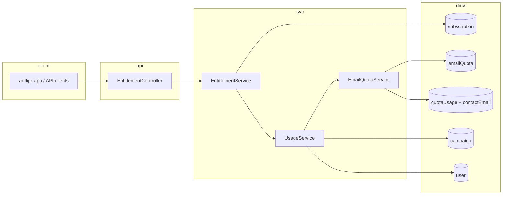

# Entitlements, subscription, usage, and related integrations

This document describes the **workspace entitlements** layer in the Java service (`service/`), how it ties to **billing subscriptions**, **usage limits**, **Shopify connect** validation, and where to extend or debug behavior.

---

## 1. Goals and scope

| Concern | What the system answers |
|--------|-------------------------|
| **Plan tier** | Which static plan snapshot applies for this workspace (`FREE` / `STANDARD` / `PREMIUM` for caps and flags). |
| **Feature gates** | Whether a named feature is allowed for the current plan, and optional upgrade hints. |
| **Numeric limits** | Limits vs **used** values for emails per month, campaigns, and users. |
| **Levels** | Non-boolean “tier” strings for filters, templates, merge tags, etc. (informational in config). |

**Out of scope here:** Razorpay/Shopify billing implementation details, invoice generation, and email send pipeline—except where they feed the same `Subscription` or quota data.

**Related (billing catalog / overlays):** How post-payment resolution must use `razorpayPlanId` and account/partner overlays — [`plan-pricing-resolution.md`](./plan-pricing-resolution.md) and `service/docs/PLAN_PRICING_POST_PAYMENT_RESOLUTION.md`. Wrong global-only price match can leave `Subscription.monthlyEmailQuota = 0` and break entitlements / plan-usage UI.

---

## 2. High-level flow

1. **`EntitlementController`** resolves the current workspace **`accountId`** via **`TokenService`**.
2. **`EntitlementService`** loads the **active billing `Subscription`** for that account and maps it to an **effective entitlement plan** (three tiers).
3. **`EntitlementService`** loads **usage** via **`UsageService`**, which builds an in-memory **`EntitlementUsage`** (short TTL cache per account): hybrid email count for the active **`EmailQuota`** period, parent **campaign** count, **user** count. **No dedicated usage collection.**
4. Static matrices in **`EntitlementPlanConfig`** and **`EntitlementUpgradeHints`** combine plan + usage into **`EntitlementsResponse`** / **`FeatureCheckResponse`**.

---

## 3. HTTP API (service)

All routes use authenticated context; **`accountId`** comes from the token, **not** from the request body (for the routes below).

### `GET /api/v1/entitlements`

- **Controller:** `com.goveca.recruit.ad.controller.EntitlementController#getEntitlements`
- **Returns:** `EntitlementsResponse` — see class Javadoc on `com.goveca.recruit.ad.response.entitlement.EntitlementsResponse` for field semantics.
- **Shape:**
  - **`plan`** — `EntitlementPlanType` after subscription resolution (`FREE` if none/expired/inactive).
  - **`features`** — `Map<String, EntitlementFeatureEntry>` with one entry per key in `EntitlementFeatureRegistry` (flags, limits, levels). Entry fields used depend on key type: booleans use `allowed` / `reason` / `upgradeTo`; limits add `limit` / `used` / `remaining`; levels add `level`. Nulls omitted on entries per `@JsonInclude(NON_NULL)`.

### `POST /api/v1/feature/check`

- **Controller:** `EntitlementController#checkFeature`
- **Body:** `FeatureCheckRequest` with **`feature`** (required string) — must be one of the keys in **`EntitlementFeatureRegistry.ALL`** (flags, limits, or levels).
- **Returns:** `FeatureCheckResponse` — **`allowed`** boolean and optional **`reason`** (`EntitlementBlockReason`).

Unknown feature keys result in a **400-style business error** (`AdGenericException`) from **`EntitlementService#checkFeature`**.

---

## 4. Plan resolution: billing `Subscription` → effective tier

### Source of truth

Entitlements **do not** use a separate `UserSubscription` document. They use the existing Mongo model:

- **Type:** `com.goveca.recruit.ad.model.Subscription`
- **Collection:** `subscription`
- **Lookup:** `SubscriptionRepositoryWrapper#findByAccountIdAndIsActiveTrue(accountId)`

### Effective plan rules (`EntitlementService#resolveEffectivePlan`)

| Condition | Effective `EntitlementPlanType` |
|-----------|-----------------------------------|
| No row, or `active != true` | `FREE` |
| `expiresOn` is strictly **before** today (`LocalDate`) | `FREE` |
| Otherwise | `EntitlementPlanType.fromSubscriptionPlanType(subscription.getPlanType())` |

So the **same** “active + not past expiry” notion used elsewhere for subscriptions should align with entitlements. If **`findByAccountIdAndIsActiveTrue`** is ambiguous in edge cases (multiple rows, stale `active`), entitlements will follow whatever that query returns—**operational consistency** depends on subscription lifecycle code keeping this invariant.

### Why not duplicate subscription documents?

A second collection for “entitlement-only subscription” would drift from billing. Using **`Subscription`** keeps **one row type** for “what plan is this workspace on?”

---

## 5. Plan type enums (three different roles)

The codebase intentionally has **more than one** “plan” enum. Do not merge them blindly.

### `SubscriptionPlanType` (billing / persistence)

- **Package:** `com.goveca.recruit.ad.enums.SubscriptionPlanType`
- **Values:** `FREE`, `STANDARD`, `PREMIUM`, `ENTERPRISE`
- **Stored on:** `Subscription.planType`, `EmailQuota.planType`, etc.

### `EntitlementPlanType` (entitlement matrix)

- **Package:** `com.goveca.recruit.ad.enums.EntitlementPlanType`
- **Values:** `FREE`, `STANDARD`, `PREMIUM` only (ordered for **`ordinal()`** comparisons).
- **Mapping:** `EntitlementPlanType.fromSubscriptionPlanType(SubscriptionPlanType)` collapses **`ENTERPRISE` → `PREMIUM`** for caps and flags (enterprise is treated as premium tier for static config).

### `PlanType` (catalog / marketing)

- **Package:** `com.goveca.recruit.ad.enums.PlanType`
- **Rich enum:** prices, copy, display limits for signup/marketing—not the driver for **`EntitlementPlanConfig`**.

**Summary:** Billing uses **four** product names; the **entitlement static config** uses **three** tiers and maps enterprise into premium.

---

## 6. Static configuration

### `EntitlementPlanConfig`

- **Class:** `com.goveca.recruit.ad.entitlement.EntitlementPlanConfig`
- Holds per-plan **`PlanSnapshot`**: maps for **flags** (boolean), **limits** (long; `-1` = unlimited where used), and **levels** (string).
- **`forPlan(EntitlementPlanType)`** returns the snapshot; unknown/null plan falls back to **FREE**.

### `EntitlementFeatureRegistry`

- **Class:** `com.goveca.recruit.ad.entitlement.EntitlementFeatureRegistry`
- **Canonical keys** for API responses and **`POST /api/v1/feature/check`**:
  - **FLAGS:** `workflow_editor`, `workflow_analytics`, `prebuilt_automation`, `comparative_reporting`, `role_based_access`, `remove_branding`, `app_integrations`, `guides`
  - **LIMITS:** `emails_per_month`, `campaigns`, `users`
  - **LEVELS:** `filters`, `templates`, `merge_tags`, `reporting_tools`, `activities`, `customer_support`
- **`ALL`** = union of the three sets.

### `EntitlementUpgradeHints`

- **Class:** `com.goveca.recruit.ad.entitlement.EntitlementUpgradeHints`
- Maps feature flags to **minimum plan** and suggests **next tier** when limits are exceeded.

---

## 7. Usage and limits (`UsageService` + `EntitlementUsage`)

### Why there is no `userUsageSnapshot` collection

Usage for entitlements is **not** stored as its own Mongo document. A separate snapshot collection would duplicate truth and risk drifting unless every send/campaign/user mutation updated it. Instead, **`UsageService`** assembles **`EntitlementUsage`** (a plain Java DTO, `@Document` **not** used) from existing collections and caches the result **in memory** for ~3 minutes per `accountId`.

**Legacy data:** older environments may still have a `userUsageSnapshot` collection from a previous version; it is **no longer read or written** by this service. You may drop that collection after verifying nothing else depends on it.

### How each limit’s “used” value is resolved

| Limit key (`EntitlementFeatureRegistry`) | Source | Implementation notes |
|------------------------------------------|--------|-------------------------|
| `emails_per_month` | **`EmailQuotaService#getEmailsUsedForActiveQuotaPeriod`** | Uses active **`EmailQuota`** for the account (same hybrid logic as quota: period dates + **`QuotaUsage`** + **`ContactEmail`**). Returns **0** if no active quota or quota expired. Failures are logged and treated as **0** so **`GET /api/v1/entitlements`** stays available. Period counts filter **`ContactEmail.created`** (not `sentAt`). **`ContactEmailRepositoryWrapper.save`** must not reset `created` on existing rows; status/tracker changes use **`update`**. |
| `campaigns` | **`CampaignRepositoryWrapper#countParentCampaignsByAccountId`** | Non-deleted, non–sub-campaign rows for the workspace (aligned with parent campaign listing scope). |
| `users` | **`UserDao#countActiveUsersByAccountId`** | Users with matching **`accountId`** and **`deleted != true`**. |

### `EntitlementService#usedFor`

Maps limit keys to **`EntitlementUsage`** fields:

| Limit key | DTO field |
|-----------|-----------|
| `emails_per_month` | `emailsSentMonth` |
| `campaigns` | `campaignsCreated` |
| `users` | `users` |

### Embargo on “stuffing” usage into unrelated documents

We **do not** add `emailsSentThisMonth` (or similar) onto **`Subscription`** or **`EmailQuota`** documents for entitlements. **`Subscription`** is billing/plan state; **`EmailQuota`** already defines period and **total** allocation—**used** is derived. Extra denormalized counters on those documents would reintroduce drift unless every code path kept them in sync.

---

## 8. Dev-only seeding (`EntitlementDevDataSeeder`)

- **Class:** `com.goveca.recruit.ad.bootstrap.EntitlementDevDataSeeder`
- **Condition:** Spring property **`adflipr.entitlements.seed.enabled=true`**
- **Requires:** three non-blank account IDs:
  - `adflipr.entitlements.seed.free-account-id`
  - `adflipr.entitlements.seed.standard-account-id`
  - `adflipr.entitlements.seed.premium-account-id`

**Behavior:**

1. For each account, upserts an **active `Subscription`** (`planType`, `purchasedOn`, `expiresOn`, `active=true`) via **`SubscriptionRepositoryWrapper`** (create **`save`** or **`update`** if an active row already exists).
2. Invalidates **`UsageService`** in-memory cache for that account so the next entitlements read recomputes **`EntitlementUsage`** from live **`EmailQuota`** / campaigns / users (no fake usage rows).

**Properties files:** see `application-dev.properties` / `application-local.properties` for defaults (`enabled=false`).

---

## 9. Shopify connect validation (related product behavior)

### Problem space (two apps, one `Session` collection)

The **Java** service and the **Shopify Remix** app both persist into the shared **`Session`** collection. Disconnect may set **`deleted: true`**. Prisma session **upserts omit `deleted`**. When **`afterAuth`** loads a row with **`deleted: true`** (shop OAuth after disconnect), it sets **`deleted: false`**, **`accountId: null`**, and appends the prior **`accountId`** to **`prevAccountIds`** (audit list on the same document). **`accountId`** / **`prevAccountIds`** are Prisma fields (`schema.prisma`) and Java **`Session`**. See **`shopify/docs/LIFECYCLE.md`** (*Disconnect*).

### `CommonUtil#shopifyValidation` behavior (high level)

- Validates **`shop`** from OAuth query params against **`SessionRepositoryWrapper`**.
- If the workspace **already has** Shopify sessions for **`accountId`**, the logic distinguishes:
  - **Same shop** (normalized host comparison: trim, lowercase, strip `http(s)://` and trailing slashes) → **idempotent success** (early return).
  - **Different shop** → error: only one Shopify store per workspace.

So reconnecting the **same** store after token refresh / soft-delete flips should not hit “already has a connected store” solely because a row still exists for that shop.

After that early check, validation loads an **active** session for the `shop` via **`SessionRepositoryWrapper#findSessionByShop`**, which requires **`deleted` ≠ `true`** (and `integrationType` = `SHOPIFY`), returning the **newest** row by `created`.

- If a non-deleted session exists for the shop with **`accountId` equal to the current workspace** → idempotent success (early return).
- If it exists with **`accountId` set to a different workspace** → error: shop already connected to another user (one Adflipr workspace per shop for active rows).
- If **no** such session → error: no session for this shop (OAuth / Connect install path must run first).
- Otherwise → **`setAccountId`** to the current workspace and update Shopify metadata (email, name, etc.): **reassigns the OAuth `Session` row** to this workspace (typically an **update**, not a second document for the same shop).

**Code:** `com.goveca.recruit.util.CommonUtil#shopifyValidation`

### Disconnect, reinstall, connect as a different workspace

- **Disconnect in the main app:** `ShopifyService#disconnectSession` sets **`deleted: true`**. **`findSessionByShop`** ignores the row until OAuth; Connect **`afterAuth`** clears **`accountId`** and updates **`prevAccountIds`** so **`connect-session`** can re-bind. **Reinstall / soft-delete** paths still apply as in **`LIFECYCLE.md`**.
- **Uninstall:** Connect persists `APP_UNINSTALLED`; Java **`handleAppUninstalled`** **soft-deletes** (`deleted: true`, `DISCONNECTED`) and runs billing cleanup. Linking again requires a **fresh active** `Session` for that shop (`deleted` not true).
- **Same store, different Adflipr user:** After disconnect/uninstall processing, the merchant reinstalls (OAuth), then the **new** user completes **connect-session** while logged in. This succeeds when the active session row has **no competing `accountId`** (or null) and the target workspace does not already have **another** Shopify store linked.

**Connect app lifecycle (install / uninstall / reinstall, `APP_UNINSTALLED`, `deleted` on Prisma):** `shopify/docs/LIFECYCLE.md`.

### Connect-session errors (reference)

User-visible strings live in **`ShopifyConnectionMessages`**. For **when each error fires**, **merchant vs ops remediation**, and clearing **“already connected to another user”**, see `shopify/docs/LIFECYCLE.md` (**Connect-session errors and troubleshooting**).

| Scenario | Typical message keyword |
|---------|--------------------------|
| Other workspace still bound on active `Session` row | already connected **another user** |
| This workspace already has another shop | Only **one store per user** |
| No OAuth row / deleted / missing install | **No session** for this shop / **properly installed** |

---

## 10. File map (quick reference)

| Area | Primary types / classes |
|------|-------------------------|
| REST | `EntitlementController`, `FeatureCheckRequest`, `EntitlementsResponse`, `EntitlementFeatureEntry`, `FeatureCheckResponse` |
| Orchestration | `EntitlementService`, `UsageService` |
| Billing row | `Subscription`, `SubscriptionRepositoryWrapper`, `SubscriptionPlanType` |
| Entitlement tier enum | `EntitlementPlanType` |
| Static matrices | `EntitlementPlanConfig`, `EntitlementFeatureRegistry`, `EntitlementUpgradeHints` |
| Usage DTO (not persisted) | `EntitlementUsage` — built by `UsageService` |
| Quota / email (used counts) | `EmailQuota`, `QuotaUsage`, `EmailQuotaService`, `QuotaUsageRepositoryWrapper`, `ContactEmailRepositoryWrapper` |
| Campaign / user counts | `CampaignRepositoryWrapper`, `UserDao` |
| Dev seed | `EntitlementDevDataSeeder` |
| Shopify connect | `CommonUtil#shopifyValidation`, `IntegrationController`, `ShopifyService` |
| Block reasons | `EntitlementBlockReason` |

---

## 11. Extending safely

1. **New boolean feature:** Add to **`EntitlementFeatureRegistry.FLAGS`**, **`EntitlementPlanConfig`** snapshots, and **`EntitlementUpgradeHints`** if upgrade messaging applies.
2. **New numeric limit:** Add to **`LIMITS`**, config maps, **`usedFor`** switch in **`EntitlementService`**, and extend **`UsageService#resolve`** (and usually **`EmailQuotaService`** or a repository) to supply **`used`**.
3. **New plan tier:** Requires new **`EntitlementPlanType`** value (ordinal order matters), full **`EntitlementPlanConfig`** snapshot, **`fromSubscriptionPlanType`** mapping from **`SubscriptionPlanType`**, and billing/catalog alignment.

---

## 12. Changelog (KB maintenance)

| Change | Notes |
|--------|--------|
| Shopify cross-workspace reconnect | Documented **disconnect → reinstall → connect-session**: **`findSessionByShop`** skips **`deleted`**, **`shopifyValidation`** reassigns **`accountId`** when no conflicting active link; **`shopify/docs/LIFECYCLE.md`**. |
| Shopify connect-session error catalog | **`LIFECYCLE.md`** § *Connect-session errors and troubleshooting*: all **`shopifyValidation`** messages, remediation for **already connected to another user**, related **`ShopifyConnectionMessages`**. |
| Disconnect + OAuth revive | **`afterAuth`** (**`shopify.server.ts`**) when **`dbSession.deleted === true`**: **`accountId: null`**, append former id to **`prevAccountIds`**, **`deleted: false`**. Prisma **`schema.prisma`** + Java **`Session.prevAccountIds`**; see **`LIFECYCLE.md`** *Disconnect*. |
| Subscription as entitlement source | Replaced entitlement-specific **`UserSubscription`** / **`userSubscription`** usage with **`Subscription`** / **`subscription`** + **`EntitlementPlanType.fromSubscriptionPlanType`**. |
| Shopify same-shop | **`CommonUtil#shopifyValidation`** returns early when the workspace’s existing Shopify session is for the **same** shop (normalized), before enforcing one-store-per-user for a **different** shop. |
| No `userUsageSnapshot` collection | **`UserUsageSnapshot`** removed; **`UsageService`** builds **`EntitlementUsage`** from **`EmailQuotaService`**, campaign count, and user count, with a short in-memory cache only. |
| Plan pricing overlays / zero email | Post-payment must resolve by **`razorpayPlanId`** then account/partner/global; see **`plan-pricing-resolution.md`**. |
| ContactEmail `created` stamp | **`save`** only stamps `created` on insert; Mailgun/unsubscribe paths use **`update`** so delivery events do not skew period usage. |

Update this table when behavior or storage changes.
