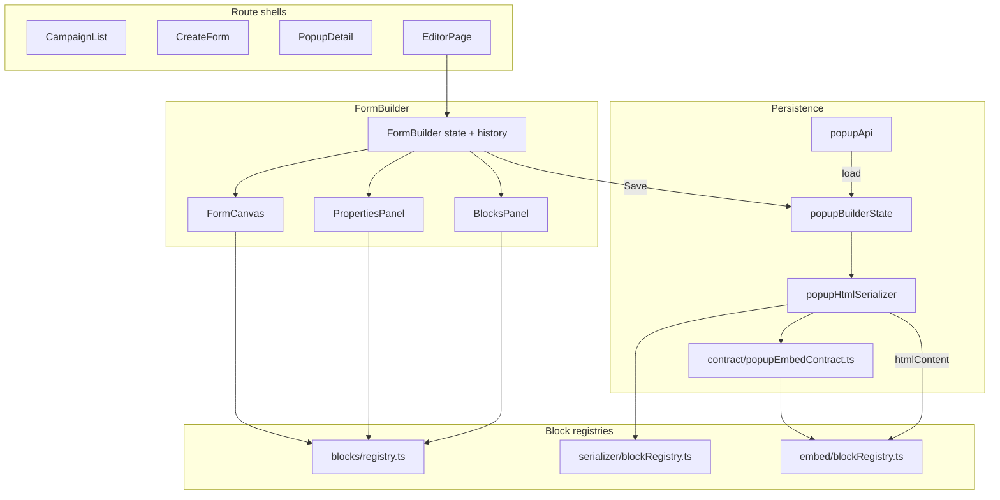

# Popup Builder Frontend — Knowledge Transfer

**Product:** Adflipr Popup Builder  
**Location:** `adflipr-app/src/layouts/PopupBuilder/`  
**Path alias:** `@pb/*` → `layouts/PopupBuilder/*` (see `tsconfig.json`, `craco.config.js`)  
**Last updated:** 2026-06-27  

**Related KB:**

- [`popup-block-registry.md`](popup-block-registry.md) — block registry contract (Phase 3 complete)
- [`popup-runtime-v2-design.md`](popup-runtime-v2-design.md) — embed runtime evolution
- [`popup-builder-structure-dnd.md`](popup-builder-structure-dnd.md) — layout/column DnD
- [`popup-html-serializer-styles.md`](popup-html-serializer-styles.md) — export CSS layout
- [`popup-embed-contract.md`](popup-embed-contract.md) — shared `data-adflipr-*` attrs
- [`popup-html-serialization.md`](popup-html-serialization.md) — export pipeline, sanitization
- [`popups-api.md`](popups-api.md) — backend `/api/v1/popups` contract

**Shorter entry point:** [`docs/POPUP_BUILDER.md`](../../docs/POPUP_BUILDER.md)

---

## Table of contents

1. [What is the “shell”?](#what-is-the-shell)
2. [Architecture](#architecture)
3. [Data model](#data-model)
4. [Code flow](#code-flow)
5. [How everything interconnects](#how-everything-interconnects)
6. [Related files by directory](#related-files-by-directory)
7. [Adding or changing a block](#adding-or-changing-a-block)
8. [State management](#state-management)
9. [Mental model cheat sheet](#mental-model-cheat-sheet)
10. [Recent changes summary](#recent-changes-summary)

---

## What is the shell?

“Shell” means several things depending on context.

### 1. Route wrappers (app shell)

Four thin entry components wrap every Popup Builder screen with shared providers:

| File | Route | Notes |
|------|-------|-------|
| `PopupBuilder.tsx` | `/popup-builder` | Forms list (inside main app sidebar) |
| `PopupBuilderCreate.tsx` | `/popup-builder/create` | Create flow |
| `PopupBuilderDetail.tsx` | `/popup-builder/detail/:id` | Analytics/detail |
| `PopupBuilderEditor.tsx` | `/popup-builder/editor/:id` | **Fullscreen editor** — top-level in `App.tsx`, no Adflipr sidebar |

Each provides: `QueryClientProvider` → `PopupBuilderModalContainerProvider` → page → toasters.

**Routing split:**

- List / create / detail → `MainContent.tsx` (with Adflipr sidebar)
- Editor → `App.tsx` top-level route (fullscreen, like Email Builder)

### 2. `.pbn-root` — CSS & portal shell

`context/PopupBuilderModalContainerContext.tsx` renders:

- A root div with class `pbn-root`
- `#pbn-modal-portal-root` for Radix/shadcn portals **inside** `.pbn-root` (not `document.body`)

Why it matters:

- Tailwind uses `important: '.pbn-root'` — styles scoped to Popup Builder
- Z-index and scoped utilities work for portaled Select/Menu/Dialog
- Detail page uses `pbn-root--no-preflight` to avoid breaking shared app chrome

### 3. Editor layout shell (`FormBuilder`)

Fixed 3-zone editor chrome:

```
Header (back, name, undo/redo, device, preview/save)
├── Tab bar (Elements | Theme | Display | Target | Code | Custom)
├── Left panel (BlocksPanel OR settings panels)
├── Canvas (FormCanvas + step strip)
└── Right panel (ElementPropertiesPanel when block selected)
```

The canvas has an **“outer shell”** div — a positioning context so the floating step strip anchors to the canvas bottom correctly.

### 4. `CanvasBlockShell` — per-block canvas wrapper

Every content block on canvas is wrapped by `blocks/shared/CanvasBlockShell.tsx`:

- Drag/drop hooks (react-dnd)
- Selection chrome (`PbnCanvasSelectionChrome`)
- Layout margins (`blocks/shared/layoutStyles.ts`)
- Preview pointer-events policy

Block definitions can opt out of selection transitions via `shell: { skipSelectionTransition: true }` (e.g. divider, checkbox, radio).

### 5. Embed host shell

`embed/host/EmbedHost.ts` is a **singleton** per window. Public API:

```ts
window.AdfliprPopup.init({ apiBaseUrl?, siteId? })
window.AdfliprPopup.mount(popupId, { mode?: 'overlay' | 'inline' })
```

---

## Architecture

### Core pipeline

```
FormElement model (JSON in metadata.builderState)
  → Builder canvas (React, block registry)
  → HTML serializer (string HTML, per-block serialize.ts)
  → Embed runtime (DOM + block initializers on storefront)
```

**Model is source of truth.** Attributes → projection. DOM/export never write back to model.

### Three registries (one block id, three layers)

| Layer | Registry | Registration file |
|-------|----------|-------------------|
| **Builder canvas** | `blocks/registry.ts` | `blocks/registerBuilderBlocks.ts` |
| **Builder properties** | same registry, `PropertiesPanel` field | `blocks/registerBuilderBlockProperties.ts` |
| **HTML export** | `utils/popupHtmlSerializer/blockRegistry.ts` | `registerPopupBlockSerializers.ts` |
| **Embed runtime** | `embed/blockRegistry.ts` | `embed/blockInitializers/*.ts` |

Each content block lives in its own folder:

```
components/form-builder/blocks/<block>/
  <Block>Canvas.tsx    ← builder render
  serialize.ts         ← HTML export (colocated)
```

**Layout blocks** (`one-column`, `two-column`, `three-column`, `section`) stay in the **structure DnD pipeline** — not in the content block registry.

**Contracts** for embed attrs: `contract/popupEmbedContract.ts` — canonical `data-adflipr-*` strings shared by serializer and runtime.

### Serializer CSS split

Export CSS lives under `utils/popupHtmlSerializer/styles/`:

```
styles/
  sheets/*.export.css     ← static shared CSS
  inline/*.ts             ← trait-driven style builders
  markup/*.ts             ← HTML fragment helpers
```

`serializeElements.ts` and `serializeLayout.ts` do assembly only — no inline CSS literals.

### Embed runtime (evolution in progress)

See [`popup-runtime-v2-design.md`](popup-runtime-v2-design.md). Already landed:

- `EmbedHost` singleton
- `fetchRetry.ts` + trigger re-arm on config failure
- `embed/blockRegistry.ts` + `DisposableStack` teardown on step change
- Block initializers: spinner, timer, video, coupon, floating-label

### Architecture diagram



---

## Data model

Canonical persisted shape: `PopupBuilderSnapshot` in `utils/popupBuilderState.ts`:

```ts
interface PopupBuilderSnapshot {
  schemaVersion?: number;
  steps: FormStep[];
  activeStep: string;
  formType: FormType;
  formPosition: FormPosition;
  formElements: StepFormElementsMap;  // Record<stepId, FormElement[]>
  formStyle: FormStyle;
}
```

- **`steps`** — multi-step flow: `step-1`, `thank-you`, `teaser`, custom steps
- **`formElements`** — flat array per step; sections/columns use `parentId`, `children`, `isLayout`
- **`formStyle`** — global theme, display settings, targeting (`targetSettings`), teaser styling, custom CSS
- **`formType`** — `popup | flyout | banner | embed | full-page`

**Save metadata** (via `buildPopupSaveMetadata`):

- `builderState` — full JSON snapshot
- `htmlByStep` — responsive HTML per step (desktop base + `@media` overrides)
- `htmlPrimaryStep` — primary step id
- Targeting fields (via `popupApiMapping.ts`)
- Unknown metadata keys preserved via `preservePassthroughMetadataKeys()`

Individual block types: `components/form-builder/types.ts` → `BlockType`, `FormElement`, `FormStyle`.

### Form types & API mapping

| UI label | `CampaignFormType` | Editor `FormType` | API `type` |
|----------|-------------------|-------------------|------------|
| Popup | `popup` | `popup` | `popup` |
| Embedded | `embedded` | `embed` | `embedded content` |
| Sticky banner | `banner` | `banner` | `sticky banner` |
| Gamification | `gamification` | `popup` (+ spinner) | `gamification` |
| Flyout | `flyout` | `flyout` | `side message` |

Mapping: `utils/popupApiMapping.ts`.

---

## Code flow

### Navigation

```
Sidebar → /popup-builder (list)
       → /popup-builder/create (type + template)
       → POST /popups → /popup-builder/editor/:id?type=...&name=...
       → Save → /popup-builder/detail/:id
```

Editor URL: `/app/popup-builder/editor/:id` (outside `AuthenticatedLayout`).

Query params: `?type=`, `?name=`, `?preview=1`, `?previewDraft=1`.

### Editor load

```
EditorPage
  → if ?previewDraft=1 → readPopupEditorPreviewSnapshot() from sessionStorage
  → else popupApi.getPopupById() → parseBuilderState(metadata)
  → FormBuilderWithLayers → FormBuilder
  → hydrate snapshot + historyReducer RESET_PRESENT
  → pass initialLoadedMetadata for save passthrough
```

### Editing

```
User action
  → FormBuilder useState updates
  → commitHistoryState() → historyReducer (500ms debounce for text)
  → FormCanvas → LayoutRenderer (sections/columns)
              → FormElementRenderer → getBuilderBlock(type).Canvas
  → Element selected → ElementPropertiesPanel
       → layout/column → SectionProperties / ColumnProperties
       → content block → registry PropertiesPanel dispatch
```

**Drag & drop** (structure pipeline — separate from content block registry):

- `structure/formStructure.ts` — `applyStructureDrop()` rule matrix
- `dnd/pbnStructureDnd.tsx` — react-dnd
- `canvas/PbnDnDZones.tsx` — `SectionDropShell`, column/root zones

Palette → canvas: `BlocksPanel` → `FormBlock` (react-dnd drag sources).

### Save

```
buildCurrentSnapshot()
  → serializePopupExport(snapshot)     // desktop + mobile HTML per step
  → popupApi.updatePopup({
       name, type, status,
       htmlContent,
       metadata: buildPopupSaveMetadata(snapshot, htmlExport, initialLoadedMetadata)
     })
```

### Preview

**Preview button** (when `popupId` exists) opens a **new tab**:

1. `writePopupEditorPreviewSnapshot()` → `sessionStorage`
2. Opens `/popup-builder/editor/:id?preview=1&previewDraft=1`
3. `EditorPage` loads draft from sessionStorage (skips API)
4. `FormBuilder` with `previewOnly={true}` renders only `FormPreview` (immersive)

**FormPreview features:**

- **Popup body** — `mountFormPreviewEmbedPresentation` → `buildPreviewEmbedConfig` / `buildPreviewArtifactExport` → `PopupEmbedRuntime` (same serializer + `initAllBlocks` as embed; includes `bindPhoneCountryFlags`)
- **Presentation shell** — overlay / flyout / banner / teaser / inline hosts match storefront (`position:absolute` inside the preview viewport)
- `FormPreviewSiteBackground` — preview over merchant store URL (iframe)
- `formPreviewSiteUrl.ts` + `formPreviewSiteCache.ts` — URL normalization + store prefill
- `simulateTeaserFlow` — teaser chip → click → serialized main popup
- Multi-step: `formElementsByStep`, button/spinner step redirects
- `immersive` mode for standalone preview tab

Utils: `utils/popupEditorPreview.ts`, `utils/formPreviewTeaserFlow.ts`, `utils/formPreviewEmbedPresentation.ts`.

### Customer-site embed

```
Script tag → window.AdfliprPopup.init()
  → EmbedHost.start()
  → PopupEmbedRuntime
  → fetch candidates + embed config (with retry)
  → TriggerWatcher (display rules)
  → inject HTML → initAllBlocks() via blockRegistry
  → DisposableStack.dispose() on step swap
```

Attrs from `@pb/contract/popupEmbedContract`.

---

## How everything interconnects

```
FormBuilder (brain)
  state: steps, formElements, formStyle, formType, activeStep
  historyReducer: undo/redo
  handlers: select, update, save, step CRUD
       │
       ├── FormCanvas
       │     LayoutRenderer (sections/columns)
       │     FormElementRenderer → registry Canvas + CanvasBlockShell
       │
       ├── PropertiesPanel (left — theme/display/target/code)
       │
       ├── BlocksPanel (palette → registry via palette.ts)
       │
       └── ElementPropertiesPanel (right — registry PropertiesPanel dispatch)
```

**Sidebar tabs** switch left panel mode:

| Tab | Left panel |
|-----|------------|
| Design (Elements) | `BlocksPanel` |
| Theme (Styles) | `PropertiesPanel` → `FormLayoutTabs` |
| Display | `DisplayPanel` |
| Target | `TargetPanel` |
| Code | `EmbedCodePanel` / `CustomCodePanel` |
| Custom | Custom code panel |

When an element is selected, the **right** panel opens `ElementPropertiesPanel` regardless of tab.

**FormElementRenderer** is thin — registry lookup + `CanvasBlockShell`:

```ts
const builderBlockDef = getBuilderBlock(element.type);
const RegistryCanvas = builderBlockDef.Canvas;
return (
  <CanvasBlockShell ...>
    <RegistryCanvas element={element} ... />
  </CanvasBlockShell>
);
```

---

## Related files by directory

### Root entry points

| File | Purpose |
|------|---------|
| `PopupBuilder.tsx` | List route shell |
| `PopupBuilderCreate.tsx` | Create route shell |
| `PopupBuilderDetail.tsx` | Detail route shell |
| `PopupBuilderEditor.tsx` | Fullscreen editor shell |

### Pages (`pages/`)

| File | Purpose |
|------|---------|
| `CampaignList.tsx` | Paginated forms list, status toggle, delete |
| `CreateForm.tsx` | Type picker, templates, scratch/import, `POST /popups` |
| `PopupDetail.tsx` | Analytics, submissions, performance charts |
| `EditorPage.tsx` | Load popup / draft preview |
| `PopupEmbedDemoPage.tsx` | Internal embed testing (`/popup-embed-demo`) |
| `Index.tsx` | Standalone demo (not main prod flow) |

### Editor core (`components/form-builder/`)

| File / area | Purpose |
|-------------|---------|
| `FormBuilder.tsx` | Central orchestrator (~2300 lines) |
| `FormBuilderWithLayers.tsx` | Layers toggle wrapper |
| `FormCanvas.tsx` | Artboard |
| `FormPreview.tsx` | Full preview overlay / preview-only tab |
| `FormPreviewSiteBackground.tsx` | Store URL iframe behind popup |
| `BlocksPanel.tsx` / `FormBlock.tsx` | Block palette |
| `PropertiesPanel.tsx` | Left settings router |
| `ElementPropertiesPanel.tsx` | Right panel — registry dispatch |
| `LayerPanel.tsx` | Layer tree |
| `types.ts` | Core TypeScript contracts |
| `formBuilderHistory.ts` | Undo/redo reducer |
| `canvas/` | Renderer, layout, styles, DnD zones, selection chrome |
| `structure/` | Section/column mutations + DnD rules |
| `dnd/` | react-dnd integration |
| `property-panels/` | Display, Target, Teaser, Embed code, Custom code |
| `property-panels/element-properties/` | Block trait UIs |
| `blocks/` | Per-block canvas + serialize + shared helpers |
| `blocks/registry.ts` | Builder block registry |
| `blocks/registerBuilderBlocks.ts` | Canvas + palette registration |
| `blocks/registerBuilderBlockProperties.ts` | Properties panel registration |
| `blocks/palette.ts` | Palette config lookup |
| `blocks/shared/CanvasBlockShell.tsx` | Shared canvas wrapper |
| `rte/RTEConfig.ts` | Rich text config |

### Contracts (`contract/`)

| File | Purpose |
|------|---------|
| `popupEmbedContract.ts` | Canonical `data-adflipr-*` attribute constants |
| `popupSpinnerContract.ts` | Spinner-specific contract |
| `index.ts` | Re-exports |

### Utils (`utils/`)

| File | Purpose |
|------|---------|
| `popupBuilderState.ts` | Snapshot parse/serialize, save metadata |
| `popupApiMapping.ts` | Editor ↔ API type/status/targeting |
| `popupEditorPreview.ts` | Preview tab URL, sessionStorage draft |
| `formPreviewSiteUrl.ts` | Normalize merchant preview URL |
| `formPreviewSiteCache.ts` | Session cache for preview site URL |
| `formPreviewTeaserFlow.ts` | Teaser flow helpers for preview |
| `popupHtmlSerializer/` | Export pipeline + styles |
| `popupTemplateSnapshots.ts` | Template → snapshot |
| `popupAnalyticsUtils.ts` | Detail page charts |
| `spinnerWheelEvents.ts`, `spinnerOutcomeSession.ts` | Spinner helpers |

### Embed (`embed/`)

| File | Purpose |
|------|---------|
| `index.ts` | `window.AdfliprPopup` bootstrap |
| `host/EmbedHost.ts` | Singleton host |
| `runtime.ts` | Presentation orchestrator |
| `blockRegistry.ts` | Embed block initializer registry |
| `blockInitializers/` | Per-block DOM init |
| `disposable.ts` | Teardown stack for step changes |
| `fetchRetry.ts` | Config fetch retry |
| `triggers.ts` | Display rules |
| `api.ts` | Fetch config / telemetry |
| `bannerLayout.ts`, `flyoutLayout.ts`, `teaserLayout.ts` | Layout positioning |
| `spinner.ts`, `timerFit.ts`, `video.ts`, `spinApi.ts` | Block runtime |

### API (outside module)

| File | Purpose |
|------|---------|
| `src/api/popupApi.ts` | REST client |
| `src/api/popupApi.types.ts` | Types |

### UI & styles

| Path | Purpose |
|------|---------|
| `components/ui/` | shadcn/Radix primitives |
| `styles/popup-builder.css` | Main scoped stylesheet |
| `context/PopupBuilderModalContainerContext.tsx` | `.pbn-root` + portal |
| `data/templates.ts`, `data/campaigns.ts` | Create-flow data |
| `types/campaign.ts` | Shared list UI types |

### Tests

- `blocks/__tests__/wave3-*` — block registry wave tests
- `utils/__tests__/blockRegistry.exhaustiveness.test.ts`
- `embed/__tests__/` — host, retry, block registry, step dispose
- `contract/__tests__/`

---

## Adding or changing a block

Five registration points for a new content block `foo`:

1. `types.ts` — add to `BlockType` + `BUILDER_CONTENT_BLOCK_TYPES`
2. `blocks/foo/FooCanvas.tsx` + entry in `registerBuilderBlocks.ts`
3. `property-panels/element-properties/FooProperties.tsx` + `registerBuilderBlockProperties.ts`
4. `blocks/foo/serialize.ts` + `registerPopupBlockSerializers.ts`
5. If interactive on storefront: `contract/` attrs + `embed/blockInitializers/foo.ts`

Exhaustiveness tests fail if any layer is missing.

**Layout blocks** follow structure DnD KB — not the content registry.

---

## State management

| Concern | Mechanism |
|---------|-----------|
| Editor document | `useState` in `FormBuilder` |
| Undo/redo | `useReducer(historyReducer)` — max 50 steps, 500ms debounce |
| Dirty tracking | `buildPopupEditorPersistFingerprint` |
| Server data | `popupApi` |
| Global app | Redux for auth/sidebar only — **not** editor state |

---

## Mental model cheat sheet

| Task | Start here |
|------|-----------|
| Block looks wrong on canvas | `blocks/<type>/*Canvas.tsx`, `blocks/shared/layoutStyles.ts` |
| Block settings UI | Registry → `property-panels/element-properties/` |
| Export HTML wrong | `blocks/<type>/serialize.ts`, `popupHtmlSerializer/styles/` |
| Storefront behavior | `embed/blockInitializers/`, `contract/` |
| New block end-to-end | All 5 registry points |
| Preview / teaser flow | `FormPreview.tsx`, `formPreviewTeaserFlow.ts`, `popupEditorPreview.ts` |
| Save/load shape | `popupBuilderState.ts`, `popupApiMapping.ts` |
| List/create/detail | `pages/CampaignList.tsx`, `CreateForm.tsx`, `PopupDetail.tsx` |
| Styling | `.pbn-root` tokens in `popup-builder.css`; Tailwind in TSX for layout |

---

## Recent changes summary

| Area | Before | Now |
|------|--------|-----|
| Block implementation | Giant switches | Per-block folders + 3 registries |
| Canvas wrapper | Inline in renderer | `CanvasBlockShell` |
| Export CSS | Mostly inline | `popupHtmlSerializer/styles/` |
| Preview | In-editor overlay | New tab + sessionStorage draft + site background |
| Embed bootstrap | Direct runtime init | `EmbedHost` singleton |
| Embed blocks | Ad-hoc inits | `blockRegistry` + `DisposableStack` |
| Contracts | Scattered attr strings | `contract/popupEmbedContract.ts` |
| HTML export | Desktop only | Desktop + mobile |
| Save metadata | Overwrites all | Passthrough unknown keys |
| Snapshot `rules[]` | Separate array | Targeting in `formStyle` only |

---

## Email Builder header parity note

`FormBuilder.tsx` mirrors Email Builder header markup (`header email-builder-header`). Flex rules for header actions are scoped under `.email-builder-root` in Email Builder CSS — **not** under `.pbn-root`. Matching rules must live in `styles/popup-builder.css` under `.header.email-builder-header`. Do not rely on importing Email Builder `components.scss` alone.
