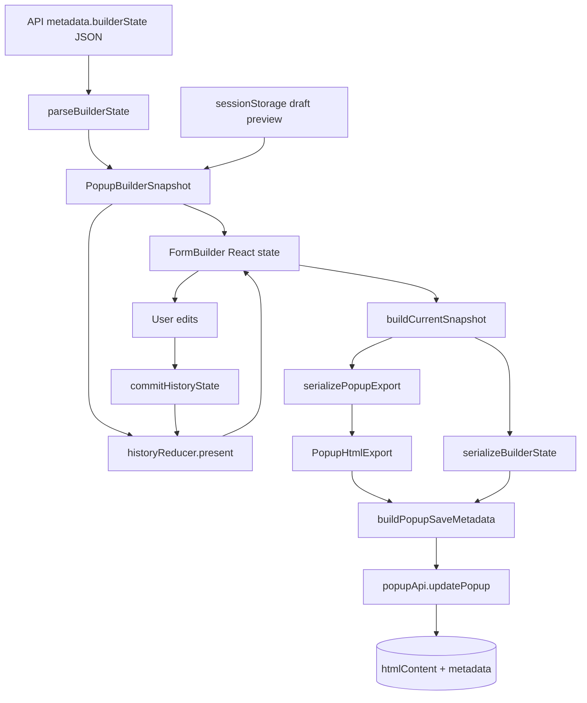
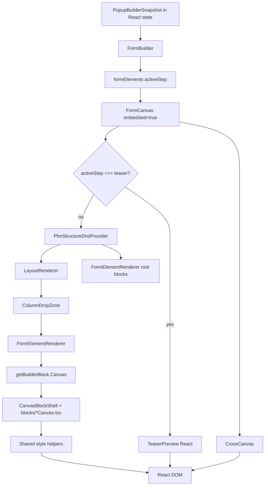
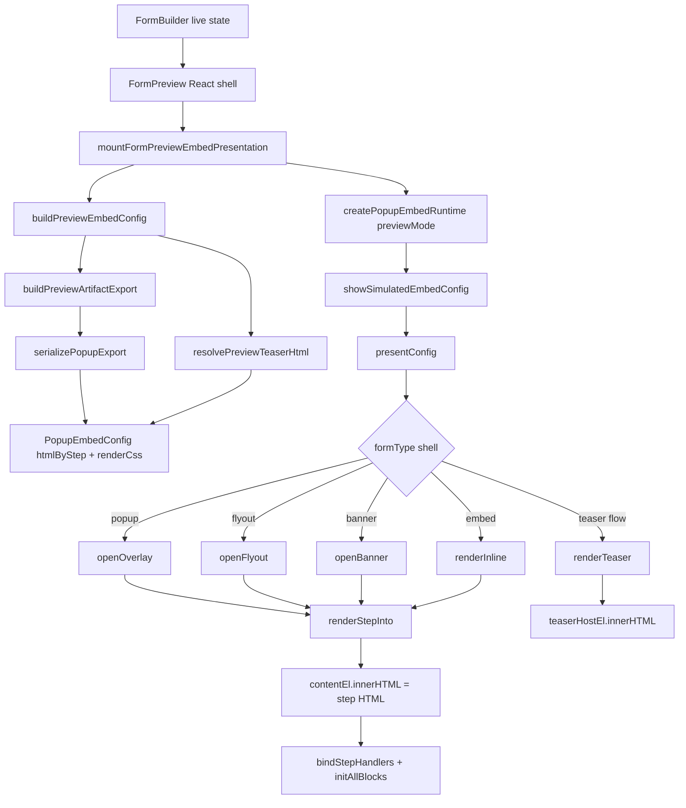
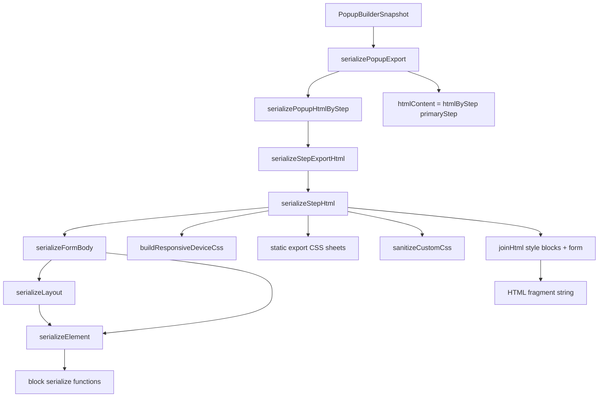
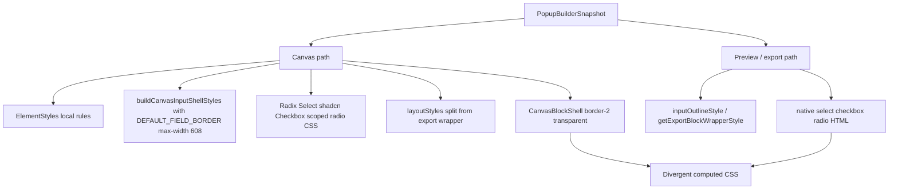
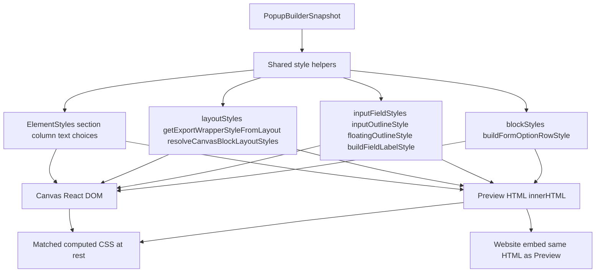
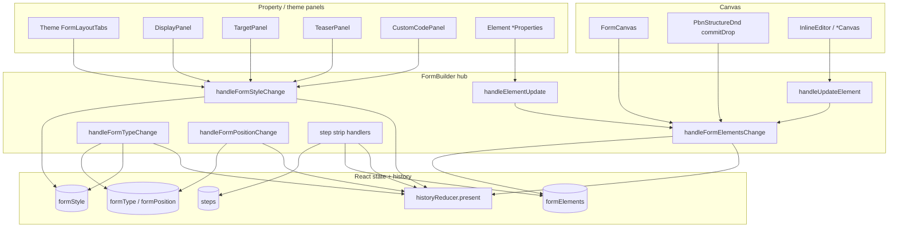

# Popup Builder — Complete Rendering Pipeline

Reverse-engineered documentation of how a popup flows from `BuilderState` to canvas, preview, save, and embed — including **who mutates state** in the editor (§10). Describes the **existing** implementation only.

**Related KB:** `popup-rendering-css-architecture.md` (**target** — HTML + `renderCss` artifact), `popup-css-lifecycle-audit.md` (as-is CSS lifecycle), `popup-html-serialization.md` (export security), `popup-html-serializer-styles.md` (CSS layout rules), `popup-embed-contract.md` (data attributes), `popup-block-registry.md` (block serializers).

**Note:** This document describes the **current** pipeline. Target storefront rendering contract is in `popup-rendering-css-architecture.md`.

**Contents:** §1 BuilderState lifecycle · §2 HTML generation · §3 CSS generation · §4 Preview · §5 Canvas · §6 Pipelines & shared styles · §7 `htmlContent` · §8 File map · §9 Mermaid · §10 Mutation boundaries

---

## 1. BuilderState lifecycle

### What `BuilderState` is

`PopupBuilderSnapshot` in `popupBuilderState.ts` is the canonical in-memory shape. It is persisted as `metadata.builderState` (JSON string).

```ts
export interface PopupBuilderSnapshot {
  schemaVersion?: number;
  steps: FormStep[];
  activeStep: string;
  formType: FormType;
  formPosition: FormPosition;
  formElements: StepFormElementsMap;
  formStyle: FormStyle;
}
```

Fields map 1:1 to `FormBuilder` React state: `steps`, `activeStep`, `formType`, `formPosition`, `formElements`, `formStyle`.

### Where it is stored

| Location | Key / field | Format |
|---|---|---|
| API (`PopupResource`) | `metadata.builderState` | JSON string |
| API | `metadata.htmlByStep`, `metadata.htmlPrimaryStepId`, `metadata.targetSettings`, etc. | strings |
| API | `htmlContent` | primary-step HTML fragment (separate from builderState) |
| Session (draft preview tab) | `sessionStorage['pbn-editor-preview:{popupId}']` | full `PopupBuilderSnapshot` JSON |
| Editor runtime | `historyReducer` `present` | `PopupBuilderSnapshot` |
| Editor runtime | React `useState` mirrors | same fields |

### Load chain

```
API PopupResource.metadata
    ↓
EditorPage (useEffect)
    ├─ previewDraft? → readPopupEditorPreviewSnapshot(popupId)
    │       ↓
    │   JSON.parse → PopupBuilderSnapshot
    └─ else → popupApi.getPopupById(popupId)
            ↓
        parseBuilderState(resource.metadata)
            ↓
        PopupBuilderSnapshot | null
    ↓
FormBuilderWithLayers → FormBuilder(initialSnapshot)
    ↓
FormBuilder useEffect (hydrate once)
    ├─ setSteps / setActiveStep / setFormType / setFormPosition
    ├─ setFormElements / setFormStyle
    └─ dispatch({ type: 'RESET_PRESENT', payload: hydrated })
```

**Files:** `pages/EditorPage.tsx`, `utils/popupEditorPreview.ts`, `utils/popupBuilderState.ts`, `components/form-builder/FormBuilderWithLayers.tsx`, `components/form-builder/FormBuilder.tsx`.

### Parse / normalize (`parseBuilderState`)

```
metadata.builderState (string)
    ↓
JSON.parse
    ↓
validate steps[], formElements, formStyle
    ↓
defaults: activeStep, formType, formPosition
    ↓
hydratePopupTargetingFromMetadata(formStyle, metadata)
    ↓
ensureFormStyleDisplaySettings(formStyle)
    ↓
PopupBuilderSnapshot
```

`ensureFormStyleDisplaySettings` strips legacy `customJs` and normalizes `displaySettings` via `normalizeDisplaySettings`.

### Every function that receives `PopupBuilderSnapshot`

| Function | File | Role |
|---|---|---|
| `serializeBuilderState` | `popupBuilderState.ts` | Wrap + `JSON.stringify` for save |
| `buildPopupSaveMetadata` | `popupBuilderState.ts` | Merge builderState + HTML + targeting metadata |
| `buildPopupEditorPersistFingerprint` | `popupBuilderState.ts` | Dirty-check fingerprint |
| `parseBuilderState` | `popupBuilderState.ts` | Load (returns snapshot) |
| `writePopupEditorPreviewSnapshot` | `popupEditorPreview.ts` | Draft preview tab |
| `resolvePrimaryStepId` | `popupHtmlSerializer/index.ts` | Pick primary export step |
| `resolveExportableStepIds` | `popupHtmlSerializer/index.ts` | Steps to include in `htmlByStep` |
| `serializePopupExport` | `popupHtmlSerializer/index.ts` | Full save/export bundle |
| `serializePopupHtmlByStep` | `popupHtmlSerializer/index.ts` | Per-step HTML map |
| `serializePopupHtml` | `popupHtmlSerializer/index.ts` | Single-step HTML |
| `serializeStepExportHtml` | `popupHtmlSerializer/index.ts` | Per-step dispatch |
| `stepHasElements` | `popupHtmlSerializer/index.ts` | Step content check |
| `historyReducer` (`SAVE_STATE` / `RESET_PRESENT`) | `formBuilderHistory.ts` | Undo/redo stack |
| `buildCurrentSnapshot` | `FormBuilder.tsx` | Assemble live snapshot from React state |
| `importPopupFromTemplate` | `popupTemplateImport.ts` | Template → new popup |
| `buildTemplateSnapshot` | `popupTemplateSnapshots.ts` | Template → snapshot |

### Transformations applied to BuilderState

**On load**

- `parseBuilderState`: JSON parse, validation, defaults, targeting hydration, display-settings normalization.

**During editing**

- User actions update React state, then `commitHistoryState` → `historyReducer` (`SAVE_STATE`, debounced for style edits).
- Undo/redo: `historyReducer` (`UNDO`/`REDO`) → `useEffect` syncs React state from `historyState.present`.

**On save**

```
buildCurrentSnapshot()
    ↓
ensureFormStyleDisplaySettings (inside buildPopupSaveMetadata)
    ↓
serializePopupExport(snapshot)          → PopupHtmlExport
    ↓
buildPopupSaveMetadata(snapshot, htmlExport, existingMetadata)
    ├─ serializeBuilderState → metadata.builderState
    ├─ JSON.stringify(htmlExport.htmlByStep) → metadata.htmlByStep
    ├─ htmlExport.primaryStepId → metadata.htmlPrimaryStepId
    ├─ mergePopupTargetingIntoSaveMetadata
    ├─ banner/flyout formPosition metadata
    └─ preservePassthroughMetadataKeys
    ↓
popupApi.updatePopup({ htmlContent, metadata, ... })
```

### Intermediate objects created

```
PopupBuilderSnapshot
    ↓ (serializePopupExport)
PopupHtmlExport { htmlContent, htmlByStep, primaryStepId }
    ↓ (serializeBuilderState)
{ schemaVersion, builderState: string }
    ↓ (buildPopupSaveMetadata)
Record<string, string> metadata
    ↓ (per step, inside serializer)
SerializeContext { device, formElements, formType, stepId, linkColor }
    ↓ (embed preview only)
PopupEmbedConfig { popupId, type, htmlByStep, htmlPrimaryStepId, formPosition?, positionOffset? }
```

### Full edit lifecycle call chain

```
User edit (trait / DnD / step change)
    ↓
FormBuilder handler (e.g. handleFormElementsChange, handleFormStyleChange)
    ↓
setState (steps | formElements | formStyle | ...)
    ↓
commitHistoryState(PopupBuilderSnapshot, { debounce? })
    ↓
historyReducer SAVE_STATE
    ↓
historyState.present = PopupBuilderSnapshot

[Save button]
    ↓
buildCurrentSnapshot()
    ↓
serializePopupExport(snapshot)
    ↓
buildPopupSaveMetadata(...)
    ↓
popupApi.updatePopup
```

---

## 2. HTML generation

### Entry points

| Entry | Caller | Output |
|---|---|---|
| `serializePopupExport(snapshot)` | `FormBuilder.handleSave`, `importPopupFromTemplate` | `{ htmlContent, htmlByStep, primaryStepId }` |
| `serializePopupHtml(snapshot, opts?)` | Tests, fallback inside export | single step HTML string |
| `serializePopupHtmlFromParts(input, opts?)` | Teaser preview (`resolvePreviewTeaserHtml`), tests, fallbacks | single step HTML string |

### Complete serialization call graph

```
serializePopupExport(snapshot, options)
    ↓
resolvePrimaryStepId(snapshot, options.stepId)
    ↓
serializePopupHtmlByStep(snapshot, { ...options, device: 'desktop' })
    ↓
resolveExportableStepIds(snapshot)
    ↓
[for each stepId]
serializeStepExportHtml(snapshot, stepId, options)
    ├─ stepId === 'teaser' && no teaser blocks?
    │       ↓
    │   serializeTeaserHtml(formStyle, 'desktop')
    └─ else
            ↓
        serializeStepHtml(elements, formStyle, formType, stepId, device, includeCross)
            ↓
        [build SerializeContext]
            ↓
        serializeFormBody(formElements, formStyle, formType, ctx, includeCross)
            ├─ layouts → serializeLayout(layout, ctx) [each layout]
            │       ├─ buildSectionLayoutStyle (via serializeLayout.buildLayoutStyle)
            │       ├─ serializeColumn → serializeElement [column children]
            │       └─ buildColumnLayoutStyle / getColumnSlotStyle
            ├─ root blocks (non-layout, non-cross, non-spinner) → serializeElement
            ├─ cross → serializeElement → serializeCross
            └─ spinner? → gamification two-column shell
            ↓
        buildResponsiveDeviceCss(formElements, formStyle, formType)
        buildRichTextLinkExportCss(linkColor)
        sanitizeCustomCss(formStyle.customCss)
            ↓
        joinHtml([
          <style data-pbn-floating-label> POPUP_FLOATING_LABEL_EXPORT_CSS
          <style data-pbn-responsive>   POPUP_EMBED_RESPONSIVE_EXPORT_CSS
          <style data-pbn-rich-text-links> buildRichTextLinkExportCss
          <style data-pbn-device>         buildResponsiveDeviceCss (if any)
          <style data-pbn-custom>         customCss (if any)
          <form data-adflipr-popup-export body>
        ])
    ↓
htmlContent = htmlByStep[primaryStepId] ?? serializePopupHtml(...)
```

### Block dispatch (`serializeElement`)

```
serializeElement(element, ctx)
    ├─ cross        → serializeCross
    ├─ floating-image → serializeFloatingImage
    └─ other        → getPopupBlockSerializer(type)  [blockRegistry]
            ↓
        registerPopupBlockSerializers() maps:
            text → serializeText
            button → serializeButton
            divider → serializeDivider
            text-input / email-input → serializeTextInputLike
            phone-input → serializePhoneInput
            textarea → serializeTextarea
            dropdown → serializeDropdown
            check-box → serializeCheckboxGroup
            radio → serializeRadioGroup
            date → serializeDate
            timer → serializeTimer
            spinner → serializeSpinner
            image → serializeImage
            video → serializeVideo
            product → serializeProduct
            coupon → serializeCoupon
            feedback → serializeFeedback
            social → serializeSocial
    ↓
wrap in <div data-block-type style="..."> via getExportWrapperStyleFromLayout (except cross/floating-image)
```

### Style helpers used during HTML assembly

- `cssUtils`: `openTag`, `closeTag`, `styleAttr`, `joinHtml`, `escapeHtml`
- `ElementStyles` (canvas module, reused): `buildSectionLayoutStyle`, `buildColumnLayoutStyle`, `getButtonStyle`, `getTextBlockContentStyle`, `getChoiceGroupShellStyle`, `buildChoiceOptionLabelStyle`, `applyInputHeightTraitToShell`, `resolveCornerRadiusCss`, `resolveDeviceBoxShadowCss`, `resolveDeviceMarginCss`, `resolveDevicePaddingCss`, etc.
- `blocks/shared/layoutStyles.ts`: `getExportWrapperStyleFromLayout`, `resolveCanvasBlockLayoutStyles` (canvas block shell margin/width — same rules as export wrapper)
- `popupHtmlSerializer/styles/inline/*`: per-block inline `style=""` builders (`inputOutlineStyle`, `floatingOutlineStyle`, `buildFieldLabelStyle`, `buildDropdownSelectStyle`, `buildFeedbackContainerStyle`, …)
- `popupHtmlSerializer/styles/markup/*`: HTML fragment helpers (labels, wrappers)
- `popupHtmlSanitize`: `sanitizeCustomCss`, `sanitizeRichTextHtml`, `applyRichTextLinkStyles`

### Responsive CSS generation (inside `serializeStepHtml`)

`buildResponsiveDeviceCss` composes (conditionally):

- `buildBlockDeviceVisibilityCss`
- `buildFormSurfaceResponsiveCss`
- `buildLayoutSectionResponsiveCss`
- `buildLayoutResponsiveCss`
- `buildBlockTraitResponsiveCss`
- `buildCrossFloatingImageResponsiveCss`
- `buildPhoneInputCountrySelectResponsiveCss`
- `buildProductHorizontalResponsiveCss`
- `buildProductGridResponsiveCss`
- `buildGamificationResponsiveCss`

Teaser-only path uses `buildTeaserExportDeviceCss` inside `serializeTeaserHtml`.

### Final HTML assembly shape

Each exported step is a **fragment** (not a full document):

```html
<style data-pbn-floating-label="true">…</style>
<style data-pbn-responsive="true">…</style>
<style data-pbn-rich-text-links="true">…</style>
<style data-pbn-device="true">…@media rules…</style>   <!-- if needed -->
<style data-pbn-custom="true">…merchant CSS…</style>  <!-- if set -->
<form data-adflipr-popup-export="true" data-adflipr-step="step-1" …>
  <div data-adflipr-popup-surface="popup" style="…">
  <!-- layouts, blocks, cross -->
  </div>
</form>
```

---

## 3. CSS generation

### A. Inline `style=""` (per-element export)

| Source | Input | Output | Called by | Injected |
|---|---|---|---|---|
| `serializeLayout` → `buildSectionLayoutStyle` | layout `properties.style` | layout div `style` | `serializeLayout` | inline on layout `<div>` |
| `serializeLayout` → `buildColumnLayoutStyle` | column traits | column div `style` | `serializeColumn` | inline |
| `serializeLayout.buildEmbeddedFormSurfaceStyle` | `FormStyle`, `FormType` | surface div `style` | `serializeFormBody` | inline on `[data-adflipr-popup-surface]` |
| `serializeElement` + `getExportWrapperStyleFromLayout` | block style, device | wrapper div `style` | `serializeElements.ts` | inline on `[data-block-type]` |
| Per-block `serialize*.ts` + `styles/inline/*.ts` | block properties | inner element `style` | block serializers | inline on inputs, buttons, images, etc. |
| `serializeCross` | cross properties | button `style` | `serializeCross` | inline (no hover in export) |
| `serializeTeaserHtml.teaserSurfaceStyle` | teaser traits | teaser chip `style` | `serializeTeaserHtml` | inline on `[data-adflipr-teaser]` |

### B. Shared inline styles (canvas + export)

Canvas and Preview/export call the same helpers for layout shells, block wrappers, inputs, labels, and choice groups. Preview HTML is the visual contract; Website embed uses the same serialized HTML.

| Concern | Shared helper(s) | Canvas consumer | Preview/export consumer |
|---|---|---|---|
| Section / column layout | `buildSectionLayoutStyle`, `buildColumnLayoutStyle`, `getColumnSlotStyle` | `LayoutRenderer`, `PbnDnDZones` | `serializeLayout.ts` |
| Block wrapper | `getExportWrapperStyleFromLayout`, `adjustLayoutWidthForHorizontalMargins`, `resolveCanvasBlockLayoutStyles` | `CanvasBlockShell` | `serializeElements.ts` |
| Text content | `getTextBlockContentStyle` | `TextCanvas` | `text/serialize.ts` |
| Input shell | `inputOutlineStyle`, `floatingOutlineStyle`, `applyInputHeightTraitToShell` | `buildCanvasInputShellStyles` | `serializeFieldHelpers`, block `serialize.ts` |
| Field labels | `buildFieldLabelStyle` | `CanvasFieldLabel` | `inputFieldMarkup.renderLabel` |
| Dropdown / checkbox / radio | `buildDropdownSelectStyle`, `buildFormOptionRowStyle`, `getChoiceGroupShellStyle`, `buildChoiceOptionLabelStyle` | `DropdownCanvas`, `CheckboxCanvas`, `RadioCanvas` (native controls) | `dropdown/serialize.ts`, `check-box/serialize.ts`, `radio/serialize.ts` |
| Feedback container | `buildFeedbackContainerStyle` | `FeedbackCanvas` | `feedback/serialize.ts` |
| Form surface | `applyFormStyleBoxShadow`, surface builders in `serializeLayout` | `FormCanvas` | `serializeLayout.ts` |

`buildCanvasInputShellStyles` delegates to `inputOutlineStyle` / `floatingOutlineStyle` — no Canvas-only shell defaults (border, `max-width: 608px`, fixed height, default background).

### C. `<style>` tag — static export sheets

| Constant | Source file | Input | Output | Called by | Injected |
|---|---|---|---|---|---|
| `POPUP_FLOATING_LABEL_EXPORT_CSS` | `styles/sheets/floating-label.export.css` | (static) | floating-label + `:focus-within` rules | `serializeStepHtml` | `<style data-pbn-floating-label>` inside form fragment |
| `POPUP_EMBED_RESPONSIVE_EXPORT_CSS` | `styles/sheets/embed-responsive.export.css` | (static) | overflow/max-width guards for spinner, phone, timer | `serializeStepHtml` | `<style data-pbn-responsive>` |

Loaded via `floatingLabelExportStyles.ts` → `styles/sheets/index.ts`.

### D. Responsive / device CSS (`@media`)

| Function | Input | Output | Called by | Injected |
|---|---|---|---|---|
| `buildResponsiveDeviceCss` | `formElements`, `formStyle`, `formType` | concatenated `@media` rules | `serializeStepHtml` | `<style data-pbn-device>` |
| `buildTeaserExportDeviceCss` | `formStyle` | teaser `@media` rules | `serializeTeaserHtml` | `<style data-pbn-device>` on teaser fragment |
| `buildRichTextLinkExportCss` | `linkColor` | `a { color }` rules scoped to export form | `serializeStepHtml` | `<style data-pbn-rich-text-links>` |

Sub-builders inside `responsiveDeviceCss.ts` handle: block visibility hide flags, form surface mobile padding/radius/width, layout column stack/gap, block trait mobile overrides, cross/floating-image margins, phone country select, product grid, gamification spinner column stack.

### E. Floating label + input shell CSS

- **Export:** `floating-label.export.css` + inline CSS vars on shells (`--pbn-canvas-input-focus`, `--pbn-floating-label-bg`) from `inputFieldStyles.ts`
- **Canvas:** `popup-builder.css` (`.pbn-canvas-input-shell`, `.pbn-floating-field`, …) — same class names and vars; shells built via `buildCanvasInputShellStyles`

### F. Hover / focus CSS

| Surface | Hover | Focus |
|---|---|---|
| **Export HTML** | Not generated for buttons/cross (no `:hover` in serializer) | `floating-label.export.css` `:focus-within` rules; focus border via CSS vars on input shells |
| **Canvas (React)** | `ButtonCanvas` `onMouseEnter`/`onMouseLeave`; `CrossCanvas` same (edit mode only) | Native input focus + floating-label CSS classes |
| **Embed runtime** | N/A (static exported HTML) | Same as export |

### G. Device CSS (desktop vs mobile toggle)

- **Export:** single HTML with `@media (max-width: 480px)` rules in `data-pbn-device` style block; `data-hide-on-desktop` / `data-hide-on-mobile` attrs on elements.
- **Canvas:** `device` prop (`'desktop' | 'mobile'`) passed to `FormCanvas` → `LayoutRenderer` / `FormElementRenderer` / `ElementStyles.resolveDevice*` — **live trait switching**, not `@media`.
- **Preview:** `FormPreview.previewDevice` → passed to `mountFormPreviewEmbedPresentation` but HTML is serialized with `device: 'desktop'`; mobile appearance comes from embedded `@media` CSS in the HTML fragment.

### H. Exported / merchant custom CSS

| Source | Input | Sanitized by | Injected |
|---|---|---|---|
| `formStyle.customCss` | merchant CSS string | `sanitizeCustomCss` | `<style data-pbn-custom>` in export; `dangerouslySetInnerHTML` in `FormCanvas` only when `isPreview=true` (unused in current editor preview path) |

### I. Embed shell CSS (not part of htmlContent)

Overlay/banner/flyout/teaser **host** positioning uses imperative `element.style.cssText` from:

- `overlayLayout.resolveOverlayHostStyle`
- `bannerLayout.resolveBannerHostStyle` / `resolveBannerContentStyle`
- `flyoutLayout.resolveFlyoutHostStyle` / `resolveFlyoutContentStyle`
- `teaserLayout.resolveTeaserHostStyle`

These wrap the serialized HTML fragment in the DOM at runtime.

---

## 4. Preview rendering

### Preview does **not** use React canvas blocks for form content

`FormPreview` is a React **chrome shell** (header, device toggle, optional site background iframe). Form content is **serialized HTML** mounted via the **embed runtime**.

```
BuilderState (React state in FormBuilder)
    ↓
FormPreview props (formStyle, formElementsByStep, formType, …)
    ↓
mountFormPreviewEmbedPresentation(presentationRootRef, options)
    ├─ buildPreviewEmbedConfig(options)
    │       ├─ buildPreviewArtifactExport(...) → serializePopupExport → htmlByStep + renderCss
    │       └─ resolvePreviewTeaserHtml(...) → teaser HTML (when simulateTeaserFlow)
    ├─ createPopupEmbedRuntime({ previewMode: {…} })
    └─ runtime.showSimulatedEmbedConfig(config)
            ↓
        presentConfig(stepId)
            ├─ overlay / flyout / banner / inline / teaser mode
            └─ renderStepInto(contentEl, stepId)
                    ↓
                container.innerHTML = resolveStepHtml(config, stepId)
                    ↓
                bindStepHandlers → initAllBlocks, phone flags, step transitions
```

### Preview entry paths

| Path | Trigger |
|---|---|
| In-editor modal | `FormPreview isOpen={showFullscreenPreview}` — **not used when `popupId` exists**; `handleFullscreenPreview` opens new tab instead |
| New-tab preview | `openPopupEditorPreviewInNewTab` → `EditorPage?preview=1&previewDraft=1` → `FormBuilder previewOnly` → `FormPreview` |
| `previewOnly` mode | Same `FormPreview` with `immersive` |

### What is React vs HTML in Preview

| Layer | Technology |
|---|---|
| Preview chrome (title bar, device buttons, site URL input) | React (`FormPreview.tsx`) |
| Sample website background | React (`FormPreviewSiteBackground` — may use iframe) |
| Popup/banner/flyout/embed surface | **HTML string** via `PopupEmbedRuntime` |
| Step transitions, spinner, phone flags | Embed `initAllBlocks` on serialized DOM |

Preview form content always goes through `mountFormPreviewEmbedPresentation` → `PopupEmbedRuntime` (same mount/hoist path as storefront). Orphan `SerializedFormPreviewCanvas` / `serializedFormPreviewMount` were removed.

---

## 5. Canvas rendering

### Call graph (editor artboard)

```
FormBuilder
    ↓
FormCanvas (embedded=true for all artboard modes; isPreview=false in main editor, true in preview-only / embedded preview paths)
    ├─ activeStep === 'teaser'
    │       ↓
    │   TeaserCanvasSiteMock
    │       └─ TeaserPreview (React, formStyle only)
    ├─ embedded=true (popup, flyout, banner, embed, fullscreen, gamification)
    │       ↓
    │   [gamification?] spinner column + form column
    │   else surface div (embeddedFormStyle)
    │       ├─ CrossCanvas (if dismissible type)
    │       └─ PbnCanvasRootZone
    │               ├─ LayoutRenderer (per layout section)
    │               │       └─ ColumnDropZone (PbnDnDZones)
    │               │               └─ FormElementRenderer (per block)
    │               │                       └─ getBuilderBlock(type).Canvas
    │               └─ FormElementRenderer (root blocks)
    └─ embedded=false (legacy path — unused by FormBuilder today)
            └─ centered artboard div + LayoutRenderer + FormElementRenderer
```

### Major components

| Component | Responsibility |
|---|---|
| `FormBuilder` | State owner, artboard layout shells (flyout mock, banner mock) |
| `FormCanvas` | Surface styles, cross, gamification split, DnD wrapper |
| `LayoutRenderer` | Section/column layout, device padding, column stack |
| `PbnDnDZones` (`ColumnDropZone`, `SectionDropShell`, `PbnCanvasRootZone`) | Structure DnD + column chrome |
| `FormElementRenderer` | Block dispatch via `registerBuilderBlocks` registry |
| `*Canvas.tsx` (per block) | Block-specific React rendering |
| `CrossCanvas` | Close button (outside block registry column flow) |
| `TeaserPreview` | Teaser chip on teaser step (React, not serializer) |
| `CanvasBlockShell` | Block layout wrapper (preview + edit); preview uses `flexShrink: 0`, no transparent border |
| `blocks/shared/layoutStyles.ts` | `resolveCanvasBlockLayoutStyles`, `getExportWrapperStyleFromLayout` — shared margin/width rules |
| `blocks/shared/buildCanvasInputShellStyles.ts` | Canvas input shells → `inputOutlineStyle` / `floatingOutlineStyle` |
| `blocks/shared/CanvasFieldLabel.tsx` | Field labels → `buildFieldLabelStyle` |
| `ElementStyles.ts` | Shared style helpers (canvas + export): section/column shells, text, choices, buttons |
| `PbnStructureDndProvider` | Drag-and-drop orchestration |

Block registration: `registerBuilderBlocks.ts` → `getBuilderBlock(type).Canvas`.

---

## 6. Pipelines & shared styles

**Visual contract:** Preview HTML == Website HTML (`metadata.htmlByStep` / `htmlContent`). Canvas targets the same computed CSS at rest (pixel parity, not DOM parity).

### Canvas pipeline

```
PopupBuilderSnapshot
    ↓
FormBuilder → FormCanvas
    ↓
LayoutRenderer + FormElementRenderer + CanvasBlockShell
    ↓
blocks/*/*Canvas.tsx (+ CrossCanvas, TeaserPreview)
    ↓
Shared style helpers (§3.B)
    ↓
React DOM (inline styles + popup-builder.css)
```

### Preview / export pipeline

```
PopupBuilderSnapshot
    ↓
serializePopupExport / serializePopupHtmlFromParts
    ↓
popupHtmlSerializer → serializeElement + block serialize.ts
    ↓
Shared style helpers (§3.B)
    ↓
HTML fragment (+ embedded <style> blocks)
    ↓
Preview: PopupEmbedRuntime.renderStepInto → innerHTML
Save:    popupApi.updatePopup
Embed:   fetchPopupEmbedConfig → innerHTML
```

### Engine differences (not style-math differences)

| | Canvas | Preview / export |
|---|---|---|
| Renderer | React components | HTML string |
| Device at website viewport | `device` prop (live trait switch) | `device: 'desktop'` base + `@media` in `data-pbn-device` |
| Hover on button/cross | JS in edit/preview canvas | Not in serialized HTML |
| Edit chrome | Selection border, DnD, placeholders, `InlineEditor` | N/A |

Style-resolution architecture change (before vs after): **§9 — Style resolution: before vs after**.

---

## 7. `htmlContent`

### First creation

```
buildCurrentSnapshot()  [or any PopupBuilderSnapshot]
    ↓
serializePopupExport(snapshot)
    ↓
serializePopupHtmlByStep → serializeStepHtml (per step)
    ↓
htmlByStep[stepId] = HTML fragment string
    ↓
htmlContent = htmlByStep[resolvePrimaryStepId(snapshot)]
```

`htmlContent` is one entry from `htmlByStep` (primary visible step with content, preferring `step-1`).

### Persistence

```
FormBuilder.handleSave
    ↓
popupApi.updatePopup({ htmlContent: htmlExport.htmlContent, metadata: { htmlByStep, builderState, … } })
```

Backend (`PopupEmbedResponse`): serves `metadata.htmlByStep`; falls back to `htmlContent` for primary step if map empty.

### htmlContent → DOM

**Preview:**

```
htmlContent (not used directly — preview re-serializes live state)
    ↓
buildPreviewArtifactExport → serializePopupExport (live snapshot)
    ↓
PopupEmbedConfig.htmlByStep + renderCss
    ↓
runtime.renderStepInto(container, stepId)
    ↓
container.innerHTML = html (+ mountRenderArtifactCss / hoistExportedStepStyles)
```

**Production embed:**

```
Saved metadata.htmlByStep
    ↓
fetchPopupEmbedConfig(popupId)  [API]
    ↓
normalizeEmbedConfig → PopupEmbedConfig
    ↓
renderStepInto → innerHTML
```

**List thumbnail (`PopupDetail`):**

```
popup.htmlContent → PopupDetailThumbnail (renders stored HTML directly)
```

---

## 8. File map

### State & persistence

| File | Responsibility | Called by | Calls |
|---|---|---|---|
| `utils/popupBuilderState.ts` | Snapshot type, parse/serialize/save metadata | `EditorPage`, `FormBuilder`, tests | `popupApiMapping`, `exportMetadata`, `flyoutLayout` |
| `utils/popupEditorPreview.ts` | Draft preview sessionStorage | `FormBuilder`, `EditorPage` | — |
| `utils/popupApiMapping.ts` | API ↔ editor type mapping, targeting metadata | `parseBuilderState`, save, preview | `DisplayPanel`, `normalizeTargetSettings` |
| `components/form-builder/formBuilderHistory.ts` | Undo/redo on `PopupBuilderSnapshot` | `FormBuilder` | — |
| `utils/popupTemplateImport.ts` | Template → popup create+save | template flows | `serializePopupExport`, `buildPopupSaveMetadata` |
| `utils/popupTemplateSnapshots.ts` | Build snapshot from campaign template | import | `popupApiMapping` |
| `pages/EditorPage.tsx` | Load popup, route to builder | router | `popupApi`, `parseBuilderState` |
| `components/form-builder/FormBuilder.tsx` | Editor orchestration, save, preview launch | `FormBuilderWithLayers` | `FormCanvas`, `FormPreview`, `serializePopupExport` |
| `components/form-builder/FormBuilderWithLayers.tsx` | Thin wrapper | `EditorPage` | `FormBuilder` |

### HTML serializer core

| File | Responsibility | Called by | Calls |
|---|---|---|---|
| `utils/popupHtmlSerializer/index.ts` | Export orchestration | save, preview, tests | `serializeLayout`, `serializeTeaser` |
| `serializeLayout.ts` | Layout/section/column/surface HTML | `serializeStepHtml` | `serializeElements`, `responsiveDeviceCss` |
| `serializeElements.ts` | Block dispatch + wrapper | `serializeLayout`, `serializeFormBody` | `blockRegistry`, block `serialize.ts` |
| `serializeTeaser.ts` | Style-only teaser chip HTML | export, preview teaser | `responsiveDeviceCss` |
| `blockRegistry.ts` + `registerPopupBlockSerializers.ts` | Serializer registry | `serializeElements` | per-block `serialize.ts` |
| `cssUtils.ts` | HTML tag/style helpers | all serializers | — |
| `popupHtmlSanitize.ts` | XSS sanitization for export | `serializeStepHtml`, text/button | — |
| `responsiveDeviceCss.ts` | `@media` CSS generation | `serializeStepHtml`, `serializeTeaserHtml` | `ElementStyles` |
| `exportMetadata.ts` | `htmlByStep` metadata keys/parsers | save, embed utils | — |
| `floatingLabelExportStyles.ts` | Re-export static CSS strings | `serializeLayout` | `styles/sheets` |
| `types.ts` | `SerializeContext`, options | serializers | — |

### Serializer styles

| File | Responsibility |
|---|---|
| `styles/sheets/floating-label.export.css` | Floating label + focus-within |
| `styles/sheets/embed-responsive.export.css` | Overflow/max-width guards |
| `styles/sheets/index.ts` | Load/normalize CSS strings |
| `styles/inline/inputFieldStyles.ts` | Input/button inline styles |
| `styles/inline/blockStyles.ts` | Text, divider, timer, etc. |
| `styles/inline/spinnerStyles.ts` | Spinner export styles |
| `styles/inline/mediaAndFeedbackStyles.ts` | Image, video, feedback, social |
| `styles/inline/commerceAndCrossStyles.ts` | Product, coupon styles |
| `styles/markup/inputFieldMarkup.ts` | Label/HTML fragments |

### Per-block serializers (`components/form-builder/blocks/*/serialize.ts`)

`text`, `button`, `divider`, `text-input` (via shared), `email-input`, `phone-input`, `textarea`, `dropdown`, `check-box`, `radio`, `date`, `timer`, `spinner`, `image`, `video`, `product`, `coupon`, `feedback`, `social`, `cross`, `floating-image`.

### Canvas rendering

| File | Responsibility |
|---|---|
| `FormCanvas.tsx` | Artboard surface, gamification, teaser step, `isPreview` branch |
| `canvas/LayoutRenderer.tsx` | Section/column layout (React); `buildSectionLayoutStyle` |
| `canvas/FormElementRenderer.tsx` | Block → registry Canvas; wraps `CanvasBlockShell` |
| `canvas/PbnDnDZones.tsx` | DnD zones, `ColumnDropZone`; `buildColumnLayoutStyle` on columns |
| `canvas/ElementStyles.ts` | Shared style helpers (canvas + export) |
| `blocks/shared/layoutStyles.ts` | Block wrapper layout: `resolveCanvasBlockLayoutStyles`, `getExportWrapperStyleFromLayout` |
| `blocks/shared/CanvasBlockShell.tsx` | Preview/edit block shell (margin, width, `flexShrink: 0` in preview) |
| `blocks/shared/buildCanvasInputShellStyles.ts` | Input shells → `inputOutlineStyle` / `floatingOutlineStyle` |
| `blocks/shared/CanvasFieldLabel.tsx` | Labels → `buildFieldLabelStyle` |
| `blocks/registerBuilderBlocks.ts` | Canvas block registry |
| `blocks/*/*Canvas.tsx` | Per-block React views (native form controls where export uses native HTML) |
| `TeaserPreview.tsx` | Teaser chip (canvas) |
| `blocks/cross/CrossCanvas.tsx` | Close button (canvas) |
| `styles/popup-builder.css` | Builder CSS (input shells, floating labels; also loaded in preview embed root) |

### Preview & embed

| File | Responsibility |
|---|---|
| `FormPreview.tsx` | Preview UI shell |
| `utils/formPreviewEmbedPresentation.ts` | Preview → embed runtime bridge (`buildPreviewEmbedConfig`, `mountFormPreviewEmbedPresentation`) |
| `utils/previewArtifactExport.ts` | Live-state → `serializePopupExport` for preview |
| `utils/serializedTeaserPreviewMount.ts` | Teaser HTML for preview config (`resolvePreviewTeaserHtml`) |
| `embed/runtime.ts` | `PopupEmbedRuntime` — shells, innerHTML, handlers |
| `embed/host/EmbedHost.ts` | Production embed bootstrap |
| `embed/utils.ts` | `normalizeEmbedConfig`, `resolveStepHtml` |
| `embed/blockRegistry.ts` + `blockInitializers/` | Post-mount JS (spinner, timer, etc.) |
| `embed/*Layout.ts` | Shell positioning CSS |
| `contract/popupEmbedContract.ts` | `data-*` attribute constants |

---

## 9. Mermaid diagrams

### BuilderState lifecycle



### Canvas rendering pipeline



### Preview rendering pipeline



### HTML serialization pipeline



### CSS generation pipeline

```mermaid
flowchart TD
  subgraph inline [Inline style attributes]
    A1[ElementStyles layoutStyles inputFieldStyles inline/*.ts] --> A2[styleAttr on HTML elements and Canvas inline styles]
  end
  subgraph static [Static style tags]
    B1[floating-label.export.css] --> B2[POPUP_FLOATING_LABEL_EXPORT_CSS]
    B3[embed-responsive.export.css] --> B4[POPUP_EMBED_RESPONSIVE_EXPORT_CSS]
  end
  subgraph dynamic [Generated style tags]
    C1[buildResponsiveDeviceCss] --> C2[@media device overrides]
    C3[buildRichTextLinkExportCss] --> C4[link color rules]
    C5[sanitizeCustomCss] --> C6[merchant customCss]
  end
  B2 --> D[serializeStepHtml cssBlock]
  B4 --> D
  C2 --> D
  C4 --> D
  C6 --> D
  A2 --> E[form body HTML]
  D --> F[complete step HTML fragment]
  E --> F
  subgraph shell [Embed shell CSS - runtime only]
    G1[overlayLayout / bannerLayout / flyoutLayout / teaserLayout] --> G2[host element.style.cssText]
  end
  F --> G2
```

### Style resolution: before vs after (parity refactor)

**Before** — Canvas and export each had separate style paths; computed CSS could diverge.



**After** — shared helpers; Preview HTML is the visual contract.



---

## 10. BuilderState mutation boundaries

This section documents **who mutates what** in the live editor — the complement to §1 (load/serialize). Use it when debugging “why did this value change?” or “why isn’t undo restoring X?”.

### 10.1 Canonical hub (`FormBuilder.tsx`)

Every field in `PopupBuilderSnapshot` is owned by React state in `FormBuilder`. **All persisted mutations** eventually touch one of these setters and (usually) `historyReducer`:

| Snapshot field | React state | Primary writers |
|---|---|---|
| `steps` | `steps` / `setSteps` | Step strip handlers, hydrate, undo/redo |
| `activeStep` | `activeStep` / `setActiveStep` | Step strip, canvas teaser click, hydrate, undo/redo |
| `formType` | `formType` / `setFormType` | `handleFormTypeChange`, hydrate, undo/redo |
| `formPosition` | `formPosition` / `setFormPosition` | `handleFormPositionChange`, `handleFormTypeChange`, hydrate, undo/redo |
| `formElements` | `formElements` / `setFormElements` | `handleFormElementsChange`, step CRUD, hydrate, undo/redo |
| `formStyle` | `formStyle` / `setFormStyle` | `handleFormStyleChange`, `handleFormTypeChange`, hydrate, undo/redo |

**Not in the snapshot** (editor-only; never serialized):

| State | Setter | Purpose |
|---|---|---|
| `activeElementId` | `setActiveElementId` | Selection chrome only |
| `device` | `setDevice` | Desktop/mobile **view** toggle (canvas + panels) |
| `formName` | `setFormName` | Save payload + dirty fingerprint (not inside `PopupBuilderSnapshot`) |
| Panel open flags | various | UI chrome |

### 10.2 History commit paths

Two mechanisms write undo history:

```
commitHistoryState(payload, options?)
    ├─ options?.debounce === true → debounce 500ms (HISTORY_DEBOUNCE_MS) then dispatch SAVE_STATE
    └─ else → dispatch SAVE_STATE immediately

dispatch({ type: 'SAVE_STATE', payload })   // direct, no debounce
```

| Handler | Fields changed | History mechanism | Debounced? |
|---|---|---|---|
| `handleFormStyleChange` | `formStyle` | `commitHistoryState` | **Yes** (default) |
| `handleFormElementsChange` | `formElements[activeStep]` | `commitHistoryState` | Only if `options.debounce` |
| `handleElementUpdate` | block/column `properties` | via `handleFormElementsChange` | **Yes** |
| `handleUpdateElement` | partial `FormElement` | via `handleFormElementsChange` | No |
| `handleAddChild` / `handleRemoveChild` | `formElements` | via `handleFormElementsChange` | No |
| `handleFormTypeChange` | `formType`, `formPosition`, `formStyle` | direct `SAVE_STATE` | No |
| `handleFormPositionChange` | `formPosition` | direct `SAVE_STATE` | No |
| `handleAddStep` | `steps`, `formElements`, `activeStep` | direct `SAVE_STATE` | No |
| `handleDeleteStep` | `steps`, `formElements`, maybe `activeStep` | direct `SAVE_STATE` | No |
| `toggleStepVisibility` | `steps[].isVisible` | direct `SAVE_STATE` | No |
| `handleStepChange` | `activeStep`, maybe `formElements` | **None** | — |
| `handleDuplicateStep` | `steps`, `formElements`, `activeStep` | **None** | — |
| `handleRenameStep` | `steps[].title` | **None** | — |
| Hydrate `initialSnapshot` | all fields | `RESET_PRESENT` (clears past/future) | — |
| Undo / Redo | all fields | `UNDO` / `REDO` → sync `useEffect` | — |

`flushPendingHistoryCommit()` flushes debounced `latestHistoryPayloadRef` before save, undo, redo, or back-navigation.

### 10.3 Master mutation graph

```
[UI surface]
    ↓
[FormBuilder handler OR child callback]
    ↓
setState (one or more snapshot fields)
    ↓
commitHistoryState(...)  OR  dispatch(SAVE_STATE)  OR  (no history)
    ↓
historyReducer.present = PopupBuilderSnapshot
```

### 10.4 Who mutates `formStyle`?

| Source | Call chain | What changes |
|---|---|---|
| **Theme panel** | `FormLayoutTabs.handleStyleChange` → `PropertiesPanel.handleFormStyleChange` → `handleFormStyleChange` | `width`, `minHeight`, `padding` / `mobilePadding`, `margin` / `mobileMargin`, `borderRadius`, `backgroundColor`, `backgroundImage`, `borderStyle`/`borderWidth`/`borderColor`, `boxShadow`, `fontFamily`, `linkColor`, `overlayColor`, `popupDisplayMode`, `transition`, flyout `positionOffset`, `fullHeight`, etc. |
| **Display panel** | `DisplayPanel` → `handleDisplaySettingsChange` → `onFormStyleChange({ …displaySettings })` | `formStyle.displaySettings` |
| **Target panel** | `TargetPanel` → `handleTargetSettingsChange` → `onFormStyleChange({ …targetSettings })` | `formStyle.targetSettings` |
| **Teaser panel** | `TeaserPanel.updateTeaserStyle` → `onStyleChange` → `handleFormStyleChange` | `teaserText`, `teaserBackgroundColor`, `teaserPadding`, `teaserPosition`, `teaserImageUrl`, `teaserHideOnDesktop`, etc. |
| **Custom code panel** | `CustomCodePanel` → `onFormStyleChange` | `customCss` (flush on blur via `onHistoryCommitFlush`) |
| **Form type change** | `handleFormTypeChange` | Resets `formStyle.width` / `height` defaults per type |
| **Legacy padding migrate** | `FormLayoutTabs` `useEffect` | Popup padding `20`/`24` → `0` (one-time style fix) |
| **Undo / redo / hydrate** | `useEffect` on `historyState.present` or hydrate effect | Full `formStyle` replace |

`OverviewPanel` receives `onFormStyleChange` but is mostly links into other panels.

### 10.5 Who mutates `formElements`?

`formElements` is `Record<stepId, FormElement[]>`. Almost all edits scope to **`formElements[activeStep]`** via `handleFormElementsChange`.

#### A. Property panel → block `properties` (traits)

```
*Properties.tsx (trait control)
    ↓
onUpdate({ ...properties, style: { ...style, [key]: value } })   // panels merge before calling
    ↓
ElementPropertiesPanel.handleElementUpdate
    ↓
PropertiesPanel.handleElementUpdate(id, properties)
    ↓
FormBuilder.handleElementUpdate(id, properties)
    ├─ regular block id → replace el.properties for matching id
    └─ column id (*-left|right|middle|single) → replace parent layout el.properties
    ↓
handleFormElementsChange(newElements, { debounce: true })
    ↓
setFormElements + commitHistoryState (debounced)
```

**Block property panels** (via `builderBlockDef.PropertiesPanel` registry):  
`TextElementProperties`, `TextInputProperties`, `EmailInputProperties`, `PhoneInputProperties`, `TextAreaProperties`, `DropdownProperties`, `CheckBoxProperties`, `RadioProperties`, `DateProperties`, `DividerProperties`, `ImageProperties`, `VideoProperties`, `TimerProperties`, `SpinnerProperties`, `ProductProperties`, `CouponProperties`, `FeedbackProperties`, `SocialProperties`, `ButtonProperties`, `ButtonCrossProperties`, etc.

Each panel writes to `element.properties` and/or `element.properties.style` through `onUpdate`.

**One-time bootstrap** (`PropertiesPanel` / `ElementPropertiesPanel` `useEffect`): auto-fills missing properties when selecting `feedback`, `cross`, layouts — same `handleElementUpdate` chain.

#### B. Property panel → layout / column structure

```
SectionProperties.onUpdate
    ↓
handleElementUpdate → mutates layout element.properties.style
    (section padding, background, column gap, columnWidths, mobileResponsive, hide flags, …)

ColumnProperties.handleColumnStyleChange
    ↓
onUpdate({ style: { …style, columnStyles: { [columnId]: { …} } } })
    ↓
handleElementUpdate(parentColumnVirtualId, properties)   // parent layout properties replaced

ElementPropertiesPanel.handleAddColumn / handleRemoveColumn
    ↓
addColumnToSection / removeColumnFromSectionByIndex (sectionColumnMutations.ts)
    ↓
onFormElementsChange(result.elements)   // immediate history

SectionProperties.onReorderColumns
    ↓
reorderColumnsInSection (formStructure.ts)
    ↓
onFormElementsChange(...)
```

#### C. Canvas inline edits (not property panel)

```
*Canvas.tsx (e.g. TextCanvas + InlineEditor)
    ↓
useCanvasElementUpdates.updateElement(partial)
    ↓
FormCanvas.handleUpdateElement(id, partial)   // merges { ...el.properties, ...updates }
    ↓
onFormElementsChange(updatedElements)   // handleFormElementsChange, NO debounce
    ↓
setFormElements + commitHistoryState (immediate)
```

Canvas path used for: RTE text content/format, inline block interactions wired through `onUpdateElement`.

#### D. Structure DnD (palette, reorder, move)

```
BlocksPanel / canvas drag
    ↓
PbnStructureDndProvider.commitDrop
    ↓
applyStructureDrop(formElements, drag, target, position)   // formStructure.ts
    ↓
onFormElementsChange(result.elements)   // immediate
```

Covers: palette drop (new block/section), block reorder, cross-step moves within active step, column/section reparenting.

#### E. Canvas destructive / duplicate actions

```
FormCanvas / LayerPanel
    ↓
removeColumnFromSection | removeSectionFromElements | duplicateColumnInSection |
duplicateSectionInElements | filter/remove element | deepCloneElement duplicate
    ↓
onFormElementsChange(newElements)   // immediate
```

#### F. Step lifecycle

| Action | `formElements` effect | History? |
|---|---|---|
| `handleAddStep` | New key with `blankFormStep(...)` | Yes |
| `handleDeleteStep` | Delete step key | Yes |
| `handleDuplicateStep` | Shallow copy `formElements[stepId]` to new key | **No** |
| `handleStepChange` | If empty step, `blankFormStep` for new `step-N` | **No** |

#### G. Form type change

`handleFormTypeChange` does **not** rewrite `formElements`; only type/position/style.

### 10.6 Who mutates `steps`?

| Source | Handler | Fields | History? |
|---|---|---|---|
| Add step (strip) | `handleAddStep` | new `step-N` entry | Yes |
| Delete step | `handleDeleteStep` / `confirmDeleteStep` | remove step | Yes |
| Duplicate step | `handleDuplicateStep` | copy metadata + new id | **No** |
| Rename step | `handleRenameStep` | `title` only | **No** |
| Show/hide step | `toggleStepVisibility` | `isVisible` | Yes |
| Hydrate / undo | effects | full `steps` | RESET / UNDO |

`steps` does **not** hold block data — only `{ id, title, isVisible }`. Block data lives in `formElements[stepId]`.

### 10.7 Who mutates `formType` / `formPosition`?

| Source | Handler | Notes |
|---|---|---|
| Theme / overview | `handleFormTypeChange` | Also resets `formPosition` + `formStyle` defaults |
| Theme (banner/flyout position) | `handleFormPositionChange` | Sticky bar top/bottom or flyout grid |
| Undo / hydrate | effects | — |

Campaign type from URL (`EditorPage`) only sets **initial** `defaultFormType`; in-editor type edits go through Theme panel.

### 10.8 Layout properties vs block properties

| Concern | Stored on | Written by |
|---|---|---|
| Section background, padding, gap, column widths, stack-on-mobile | `layout.properties.style` (`isLayout: true`) | `SectionProperties`, DnD layout creation |
| Column align, padding, margin, radius, hide | `layout.properties.style.columnStyles[columnId]` | `ColumnProperties` |
| Block typography, colors, actions, field labels | `block.properties` + `block.properties.style` | Block `*Properties` panels, canvas inline |
| Cross button position/size/colors | `cross.properties` (not under `style` for several fields) | `ButtonCrossProperties`, bootstrap effect |
| Gamification spinner slices | `spinner.properties.slices` | `SpinnerProperties` |
| Theme surface (popup width, form padding) | `formStyle` | `FormLayoutTabs` |
| Teaser chip | `formStyle.teaser*` | `TeaserPanel` |
| Display triggers / frequency | `formStyle.displaySettings` | `DisplayPanel` |
| Geo / URL targeting | `formStyle.targetSettings` | `TargetPanel` |

**Debugging tip:** Column trait edits route through a **virtual column id** but `handleElementUpdate` writes the **parent layout’s** `properties` object. Column panels pass `{ style: … }` only — not a deep merge of unrelated parent keys.

### 10.9 Trait panel → snapshot (example traces)

**Text input border color**

```
TextInputProperties.handleStyleChange(key, value)
    ↓
onUpdate({ ...properties, style: { ...style, [key]: value } })
    ↓
handleElementUpdate(elementId, mergedProperties)
    ↓
handleFormElementsChange (debounced)
    ↓
formElements[activeStep][i].properties.style.borderColor = value
```

**Section column gap**

```
SectionProperties → onUpdate({ style: { ...style, columnGapDesktop: value } })
    ↓
[same chain as above]
    ↓
layout.properties.style.columnGapDesktop
```

**Palette drop (new button)**

```
commitDrop → applyStructureDrop
    ↓
onFormElementsChange (immediate)
    ↓
new FormElement appended to formElements[activeStep]
```

**Theme width**

```
FormLayoutTabs.handleThemeDimensionChange
    ↓
handleStyleChange('width', value)
    ↓
handleFormStyleChange({ ...formStyle, width: value })   // debounced
```

**Display “show after delay”**

```
DisplayPanel
    ↓
handleDisplaySettingsChange
    ↓
onFormStyleChange({ ...formStyle, displaySettings })
    ↓
handleFormStyleChange (debounced)
```

### 10.10 Read-only / non-mutating paths

These **read** snapshot state but do not write it:

- `FormPreview` / `serializePopupHtmlFromParts` (preview serializes a copy path)
- `buildCurrentSnapshot` (read for save)
- `getActiveElement` (derived view)
- `PopupDetailThumbnail` (reads saved `htmlContent`, not live state)

### 10.11 Mutation diagram (Mermaid)



### 10.12 Common “why did this change?” scenarios

| Symptom | Likely writer |
|---|---|
| `formStyle.width` jumped on type switch | `handleFormTypeChange` default widths |
| Popup padding became `0` | `FormLayoutTabs` legacy padding migration `useEffect` |
| New empty step gained default layout + cross | `handleStepChange` → `blankFormStep` |
| Block moved columns | `applyStructureDrop` via DnD |
| `properties.style` partially wiped on column edit | `handleElementUpdate` full `properties` replace for parent layout |
| Undo skipped last rename / duplicate step | `handleRenameStep` / `handleDuplicateStep` omit history |
| Rapid trait typing coalesced to one undo step | `handleElementUpdate` debounce |
| `displaySettings` changed without opening Display | Target/Display handlers both write `formStyle` — check panel history |
