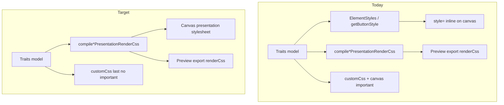

# Popup Builder — Canvas Presentation via `renderCss` Migration  
## Decision and Implementation Readiness

**Date:** 2026-08-01  
**Status:** DECIDED — **P0–P5 implemented** (2026-08-02); P6 cleanup PENDING  
**Mode:** contract + architecture + phased plan — **follow this document; do not invent paths**  
**Related:**  
- [`popup-block-custom-class-css-contract-decision-and-readiness.md`](./popup-block-custom-class-css-contract-decision-and-readiness.md) (Track 2B customClass/customCss S2)  
- [`popup-rendering-css-architecture.md`](./popup-rendering-css-architecture.md)  
- [`popup-saved-artifact-storefront-css-parity-phase-g2e-audit.md`](./popup-saved-artifact-storefront-css-parity-phase-g2e-audit.md)  
- [`popup-builder-rendering-pipeline.md`](./popup-builder-rendering-pipeline.md)

---

## 1. Executive verdict

| Question | Answer |
|----------|--------|
| Move edit-canvas merchant paint off React **inline** `style={…}`? | **YES — selected** |
| Put merchant trait values in static [`popup-builder.css`](../../adflipr-app/src/layouts/PopupBuilder/styles/popup-builder.css)? | **NO — rejected** |
| Mechanism? | Inject **generated** presentation CSS from existing `compile*PresentationRenderCss` compilers, scoped under `pbn-edit-canvas` (same selectors as export) |
| Why now? | Live block customCss on canvas loses to trait inline styles unless canvas-only `!important`; Preview/export already share one stylesheet channel |

**Verdict:** **ACCEPT WITH PHASED IMPLEMENTATION** — start with shared infra + button pilot; expand family-by-family.

**Agent rule:** If a choice is not written here → **ask**; do not invent.

---

## 2. Current state vs target state

### 2.1 What we currently have

```text
EDIT CANVAS (FormCanvas / *Canvas.tsx)
  App / popup-builder.css  →  builder chrome only
  React inline style={…}   →  merchant trait paint for non-migrated families
  CanvasPresentationStyle  →  compileCanvasPresentationRenderCss (button pilot; pbn-edit-canvas)
                              mobile @media rewritten to [data-pbn-canvas-device=mobile]
  BlockCustomCssCanvasStyle →  compileBlockCustomCssRenderCss last (no canvas !important)

PREVIEW / EXPORT / STOREFRONT
  serializePopupExport → compilePopupRenderCss (family compilers + customCss last)
  HTML structure-only + [data-adflipr-block-id] + artifact scope
  No React; merchant paint is stylesheet renderCss
```

| Surface | Merchant trait paint | Block customCss | Cascade |
|---------|----------------------|-----------------|--------|
| **Edit canvas** | Presentation sheet for **migrated families** (button…spinner); React **inline** for residual layout surface | Stylesheet under `pbn-edit-canvas` (after presentation) | Migrated: customCss wins by order |
| **FormPreview / export / embed** | Artifact **`renderCss`** via `compile*PresentationRenderCss` | Same compilers; **last chunk** | CustomCss wins by order |

**Already working pieces we keep:**

| Piece | Role |
|-------|------|
| `compilePopupRenderCss` + `*Presentation.ts` | Source of truth for merchant presentation selectors |
| `[data-adflipr-block-id]` on `CanvasBlockShell` | Block scoping |
| `data-adflipr-popup-artifact="pbn-edit-canvas"` + `data-pbn-canvas-device` on FormCanvas surfaces | Artifact + builder device toggle |
| `CanvasPresentationStyle` | Live family presentation (P0; button in P1) |
| `BlockCustomCssCanvasStyle` | Live customCss injection (after presentation) |
| Track 2B painted CSS roots | Unchanged |

### 2.2 What we are trying to achieve

```text
EDIT CANVAS (target)
  App / popup-builder.css     →  builder chrome ONLY (selection, DnD, panels)
  Canvas presentation sheet   →  same compile*PresentationRenderCss as export
                                  scope: pbn-edit-canvas
  BlockCustomCssCanvasStyle   →  same compileBlockCustomCssRenderCss, NO !important
  *Canvas.tsx                 →  structure + behavior; no merchant trait inline paint

PREVIEW / EXPORT / STOREFRONT
  Unchanged (already the target model)
```

| Goal | Meaning |
|------|---------|
| One paint channel | Canvas merchant presentation = generated CSS from the **same compilers** as export |
| CustomCss honesty | Add-on overrides traits on canvas **without** `!important` (stylesheet order, customCss last) |
| No static merchant CSS | Dynamic trait values never land in `popup-builder.css` |
| Keep editor chrome separate | Selection outlines, drag indicators, etc. stay React / chrome CSS |
| Export contract frozen | Storefront HTML/`renderCss` shape does not change for this migration |



---

## 3. Selected approach (locked)

### 3.1 Selected

**Canvas consumes generated presentation CSS** from existing serializers:

- Reuse `compileButtonPresentationRenderCss`, `compileTextPresentationRenderCss`, … (same as `compilePopupRenderCss` chunk list).
- Inject one (or few) `<style>` tags on edit canvas under artifact scope **`pbn-edit-canvas`** (`CANVAS_BLOCK_CUSTOM_CSS_ARTIFACT_SCOPE` already defined).
- Prefer extending the existing FormCanvas injection pattern (`BlockCustomCssCanvasStyle` / sibling “presentation” injector), with `useDeferredValue` / debounce on trait edits.
- Strip **merchant** inline from `*Canvas.tsx` per family as that family migrates.
- Compile order on canvas must mirror export: **family presentation chunks first, `compileBlockCustomCssRenderCss` last**.

### 3.2 Rejected

| Approach | Why rejected |
|----------|--------------|
| Merchant rules in `popup-builder.css` | Static file cannot express per-block trait values; wrong layer (chrome vs product CSS) |
| Keep inline forever + canvas `!important` | Works as bridge; wrong long-term cascade; hides dual-path drift |
| Rewrite export to match canvas inline | Export already correct; would regress storefront architecture |
| One giant PR migrating all families | Too risky; no go/no-go checkpoint |
| Changing Track 2B customClass/customCss grammar in this track | Out of scope — already decided in Track 2B KB |

### 3.3 What may remain inline (allowed exceptions)

List **exhaustively**; anything else merchant-facing must move to presentation CSS when its family migrates:

| Allowed inline / non-presentation | Reason |
|-----------------------------------|--------|
| `CanvasBlockShell` selection outline / DnD opacity | Editor chrome |
| Structure pass-through / drag indicators | Editor chrome |
| RTE **content** formatting inside text/button labels (**selection spans** in `properties.content` only) | Content model, not block traits — see RTE KBs |
| Transient empty-state placeholders that are editor-only | If not exported; document per family |
| `display:none` on hidden native inputs where export also uses structural hiding | Prefer matching export; if export uses CSS, prefer CSS |

**Not allowed:** InlineEditor **host** (`div.inline-editor`) trait/chrome styles (font-size, color, padding, border, etc.). For button (P1) and text (P4): host chrome + `font-size: inherit` live in **canvas-only** presentation CSS (`compileButtonLabelHostCanvasCss` / `compileTextLabelHostCanvasCss` under painted `.inline-editor`). Balloon toolbar may still read a `fontSize` prop for UI state without writing it to the host.

Painted button selectors use `[block-id] > div:where(:not(.element-actions):not(.elementalbelselection)) button` so canvas selection chrome (label chip + action bar, also direct-child `<div>`s) is not painted. Text content selectors use the same chrome exclusion on `[block-id] > div…` (Phase 5D painted owner). `:where()` keeps exclusion at zero specificity so customCss still beats trait paint. Align container uses the same filter.

**P4 (text, 2026-08-02):** CanvasBlockShell skips the intermediate layout shell for text so the painted root is the direct `[block-id] > div` (export parity). Trait paint via `compileTextPresentationRenderCss`; RTE host via `compileTextLabelHostCanvasCss`. Do not strip legitimate content inline from RTE spans. Host must not get `text-align` via InlineEditor DOM write (`elementType` text/button skip + `removeProperty`). Wrapper width shrink (`adjustLayoutWidthForHorizontalMargins` inside `resolveTextWrapperCssRules`) keeps presentation `width`+`margin` from overflowing the column (preview/export parity with canvas layout helper).

**P2 follow-up (customCss specificity):** Timer/coupon layout hops use `> :where(.pbn-*-block-layout)` so trait shell selectors stay ≤ `[artifact] [block-id] .merchantClass`. Image painted selector uses `:where([data-adflipr-image])`; image `customClass` lives on `.pbn-image-painted` (not the shell) so merchant `border-radius` / `object-fit` hit the media node.

**P3 follow-up (choice option labels):** Checkbox/radio option-label selectors wrap internal `pbn-export-native-*-scope` / `pbn-display-*-row` in `:where()` so Track 2B `.myClass label { font-size }` beats trait typography without merchant `pbn-*` knowledge. Group hosts use `:where(.pbn-export-native-*-scope)` similarly.

**P3 polish (shell fields, 2026-08-02):** Standard / textarea / dropdown / phone outline + value hops use `:where(.pbn-canvas-input-shell)` (and related). Outline height model is `min-height` + `height: auto` so merchant shell padding can grow the box without leftover trait `height: 48px` overflow. Static field titles outside `customClass` remain deferred.

If unsure → treat as merchant presentation → migrate or ask.

---

## 4. DOM / cascade contracts (locked)

| Contract | Value |
|----------|--------|
| Artifact scope (edit canvas) | `pbn-edit-canvas` |
| Artifact scope (FormPreview embed) | `pbn-preview` (unchanged; must not collide) |
| Block id attr | `data-adflipr-block-id` on shell (unchanged) |
| Canvas device attr | `data-pbn-canvas-device="desktop"\|"mobile"` on artifact root (FormCanvas). **Why:** builder mobile mock is ~375px inside a wide browser window; export `@media (max-width: 480px)` would not fire. Canvas presentation rewrites those media blocks to require this attr (export CSS unchanged). |
| Button customClass | Painted `<button>` (descendant binding) — Track 2B |
| Other blocks customClass | Painted CSS root (descendant) except spinner (wrapper compound) — Track 2B |
| CustomCss position | Last chunk after family presentation |
| Canvas `forceImportantCssDeclarations` | **Removed** from live path; global cleanup of any leftover helpers in P6 if needed |

---

## 5. Family inventory (migration status)

Update the **Status** column as work lands. Do not start a family without an existing presentation compiler (or an explicit KB amendment).

| Family | Canvas | Presentation compiler | Phase | Status |
|--------|--------|----------------------|-------|--------|
| button | `blocks/button/ButtonCanvas.tsx` | `buttonPresentation.ts` | P1 | **DONE** (2026-08-01; host RTE no-inline; chrome exclusion via `:where(:not(.element-actions):not(.elementalbelselection))`) |
| divider | `divider/DividerCanvas.tsx` | `dividerPresentation.ts` | P2 | **DONE** batch 1 (2026-08-01) |
| image | `image/ImageCanvas.tsx` | `mediaPresentation.ts` | P2 | **DONE** batch 1 (2026-08-01) |
| video | `video/VideoCanvas.tsx` | `mediaPresentation.ts` | P2 | **DONE** batch 1 (2026-08-01) |
| coupon | `coupon/CouponCanvas.tsx` | `couponPresentation.ts` | P2 | **DONE** (2026-08-01; `.pbn-coupon-block-layout` on CanvasBlockShell) |
| social | `social/SocialCanvas.tsx` | `socialPresentation.ts` | P2 | **DONE** (2026-08-01) |
| timer | `timer/TimerCanvas.tsx` | `timerPresentation.ts` | P2 | **DONE** (2026-08-01; `.pbn-timer-block-layout` on CanvasBlockShell; fit via presentation CSS) |
| product | `product/ProductCanvas.tsx` | `productPresentation.ts` | P2 | **DONE** (2026-08-01) |
| feedback | `feedback/FeedbackCanvas.tsx` | `feedbackPresentation.ts` | P2 | **DONE** (2026-08-01) |
| cross / floating-image | `cross/`, `floating-image/` | `positionedDecorativePresentation.ts` | P2 | **DONE** (2026-08-01) |
| text-input / email / date | `*InputCanvas` / `DateCanvas` | `standardFieldPresentation.ts` | P3 | **DONE** (+ polish 2026-08-02: shell `:where` + outline `height:auto`) |
| textarea | `textarea/TextareaCanvas.tsx` | `textareaPresentation.ts` | P3 | **DONE** (+ polish 2026-08-02: shell `:where`) |
| dropdown | `dropdown/DropdownCanvas.tsx` | `dropdownPresentation.ts` | P3 | **DONE** (+ polish 2026-08-02: shell `:where` + outline `height:auto`) |
| phone-input | `phone-input/PhoneInputCanvas.tsx` | `phoneInputPresentation.ts` | P3 | **DONE** (+ polish 2026-08-02: shell `:where` + outline `height:auto`) |
| radio | `radio/RadioCanvas.tsx` | `radioPresentation.ts` | P3 | **DONE** (2026-08-01; option-label hops in `:where` so `.myClass label` beats traits) |
| check-box | `check-box/CheckboxCanvas.tsx` | `checkboxPresentation.ts` | P3 | **DONE** (2026-08-01; option-label hops in `:where` so `.myClass label` beats traits) |
| text | `text/TextCanvas.tsx` | `textPresentation.ts` | P4 | **DONE** (2026-08-02; shell flatten + chrome `:where`; host RTE no-inline) |
| spinner | `spinner/SpinnerCanvas.tsx` | `spinnerPresentation.ts` + gamification | P5 | **DONE** (2026-08-02; outer/root/canvas hooks + gamification attrs) |
| form surface / columns / outer layout | FormCanvas / LayoutRenderer | `formSurfacePresentation`, `columnPresentation`, `columnsContainerPresentation`, `outerLayoutPresentation` | P0–P2 as needed | PENDING |
| teaser | Teaser canvas | `teaserPresentation.ts` | separate / later | OUT OF PRIMARY SCOPE |

---

## 6. Phased plan and exit criteria

### Effort (planning only)

| Scope | Eng time (1 familiar engineer) |
|-------|--------------------------------|
| P0 + P1 (infra + button) | ~1 week |
| Full content migration P0–P6 | ~3–5 weeks eng; ~4–7 weeks calendar |

### P0 — Canvas presentation pipeline

**Do:**

- Shared injector for presentation CSS (sibling to `BlockCustomCssCanvasStyle` or generalized canvas CSS host).
- Compile active-step `formElements` through the **same chunk order** as `compilePopupRenderCss` (subset OK for pilot; full order before multi-family).
- Scope `pbn-edit-canvas`; defer while typing.

**Exit:**

- [x] Injector mounts/tears down cleanly with FormCanvas surfaces (main / embedded / gamification).
- [x] Empty snapshot → no empty noise stylesheet (or empty string → no tag).
- [x] Unit test: emitted CSS contains artifact + block-id selectors from a known compiler.

**Do not:** strip inline from families yet (except as needed for P1).

### P1 — Button pilot (go / no-go)

**Do:**

- Remove merchant `style={buttonStyles}` (and align-container merchant paint if owned by presentation) from `ButtonCanvas`.
- Drive paint via `compileButtonPresentationRenderCss` on canvas.
- Parity: desktop + mobile device toggle; hover if presentation emits hover.
- Keep behavior (submit / next-step / preview navigate) unchanged.

**Exit:**

- [x] Button canvas has no merchant trait inline for properties owned by `buttonPresentation`.
- [x] Visual match vs Preview for representative traits (manual smoke; presentation selectors shared with export).
- [x] Unit: canvas presentation emits painted selectors; ButtonCanvas has empty `style` on `<button>`.
- [x] Block customCss overrides trait `background` on canvas **without** `!important` (presentation then customCss order).
- [x] Team accepts approach → unlock P2 (batch 1: divider + media started 2026-08-01).

**No-go:** If parity or hover/device is broken after honest attempt → stop; amend KB; do not silently reintroduce dual paths.

### P2 — Simple paint families

divider, image, video, coupon, social, timer, product, feedback, cross/floating-image (+ layout surface chunks if still inline-merchant).

**Batch 1 (2026-08-01):** divider + image + video — canvas DOM hooks aligned with export (`.pbn-image-painted`, `data-adflipr-video-frame` / `.pbn-video-frame--*`); structural image/video export sheets included in canvas presentation CSS.

**Remaining P2 (2026-08-01):** coupon + social + timer + product + feedback + cross/floating-image — all compilers wired in `compileCanvasPresentationRenderCss` (export relative order); form-scoped structural sheets rewritten to artifact; coupon/timer layout classes on CanvasBlockShell inner.

**Exit per family:** same checklist as P1 (no merchant inline for presentation-owned props; parity smoke).

### P3 — Form fields

standard fields, textarea, dropdown, phone, radio, checkbox.

**Extra care:** floating labels, focus rings, export CSS vars — match export selectors, don’t invent canvas-only class names.

**Status (2026-08-01):** Compilers + structural sheets (floating-label / radio / checkbox export CSS rewritten to artifact) wired in `compileCanvasPresentationRenderCss`. Radio/checkbox canvases use export native scopes; date canvas uses `.pbn-date-field-*` hooks. Static labels use shared `.pbn-field-static-label`.

**Polish (2026-08-02):** Shell-field `:where(.pbn-canvas-input-shell)` + outline `min-height`/`height:auto` (standard/dropdown/phone). Choice option-label `:where` retained.

**Exit:**

- [x] No merchant trait inline on presentation-owned field paint (shell / input / select / group / date trigger).
- [x] Canvas DOM hooks match export (floating field, native radio/checkbox scopes, date field hooks).
- [x] Unit: `compileCanvasPresentationRenderCss` emits P3 selectors; canvas strip tests (`*.p3.test.tsx`).
- [x] Track 2B: shell-field + choice option-label presentation ≤ merchant `.myClass` specificity; outline grows with merchant padding without fixed-height overflow.

### P4 — Text + RTE

Trait paint via `textPresentation`; RTE content formatting stays per RTE KBs.

**Do not** strip legitimate content inline from RTE spans as part of this track without citing RTE ownership docs.

**Exit:**

- [x] No merchant trait inline on painted text content div or InlineEditor host.
- [x] Canvas DOM: text painted root is direct `[block-id] > div` (layout shell skipped); selectors exclude selection chrome via `:where`.
- [x] Unit: `compileCanvasPresentationRenderCss` emits text selectors; `textCanvasPresentation.p4.test.tsx`.
- [x] `formStyle.linkColor` passed into canvas text compiler for export parity.

### P5 — Spinner / gamification

Treat as its own PR; mixed layout + mechanics.

**Exit:**

- [x] `compileSpinnerPresentationRenderCss` + gated `compileGamificationRenderCss` in `compileCanvasPresentationRenderCss` (after timer; match export order).
- [x] Canvas DOM hooks aligned with export: `.pbn-spinner-outer`, `[data-adflipr-popup-spinner]`, `.pbn-spinner-canvas-host`, `[data-adflipr-popup-spinner-canvas]`, result card classes.
- [x] Merchant trait padding/width/margin stripped from SpinnerCanvas / SpinWheel / canvas block layout shell (wrapper owned by presentation; export wrapper via `getExportWrapperStyleFromLayout` spinner branch).
- [x] Gamification surface/column attrs on FormCanvas; column width/padding from presentation CSS.
- [x] Unit: `spinnerCanvasPresentation.p5.test.tsx` + canvasPresentationCss emit coverage.
- [x] Spin mechanics untouched (`embed/spinner.ts`, draw, email gate, outcome).

### P6 — Cleanup

- [ ] Remove `forceImportantCssDeclarations` (and tests that require it).
- [ ] Delete dead canvas-only merchant style helpers if unused.
- [ ] Update this KB Status column + executive “IMPLEMENTED” when done.
- [ ] Cross-link Track 2B KB: canvas customCss no longer needs `!important`.

---

## 7. Test contract

| Layer | Requirement |
|-------|-------------|
| Unit | Canvas injector emits expected selectors for fixture elements |
| Presentation | Existing `*PresentationRenderCss.test.ts` remain green (export unchanged) |
| Browser / harness | Prefer reuse `responsiveCssBaselineHarness` / family browser tests; add canvas mount only when needed |
| CustomCss | After button (or full) migration: canvas customCss beats trait background **without** canvas `!important` |
| Regression | Guardrails: export still has no merchant presentation inline on wrappers where architecture forbids it |

---

## 8. Interaction with Track 2B (customClass / customCss)

| Topic | Rule |
|-------|------|
| customClass placement | Painted CSS root for mismatch families (descendant); spinner wrapper; button control |
| customCss compiler | Unchanged (`blockCustomCssPresentation.ts`) |
| Live canvas customCss | Remains after presentation; no canvas `!important` for button (P1). Global leftover cleanup in P6 if needed |
| Form-level `formStyle.customCss` | Still preview-only raw inject; **out of scope** |

---

## 9. Non-goals (hard)

- Merchant presentation CSS authored into `styles/popup-builder.css`
- Changing storefront embed mount order or export HTML schema
- Enabling form-level customCss on edit canvas
- Block customCss `@media` / at-rules (still v1 drop)
- Mass-migrating Advanced textarea UI to `BlockCustomCssField` for all panels (optional follow-up)
- Email Builder / Shopify / WordPress canvas changes

---

## 10. Anti-hallucination checklist (agents & PRs)

Before implementing or reviewing:

1. [ ] Does this PR cite **this KB** and a phase id (P0–P6)?
2. [ ] Are merchant styles coming from an **existing** `compile*PresentationRenderCss`?
3. [ ] Is artifact scope **`pbn-edit-canvas`**, not `pbn-preview` or a new invented id?
4. [ ] Is anything being added to `popup-builder.css` for trait values? → **reject**
5. [ ] Is export/`compilePopupRenderCss` being “simplified” to match old canvas inline? → **reject**
6. [ ] Are selection/DnD chrome still working without stuffing them into presentation CSS?
7. [ ] For text/RTE: was an RTE ownership KB consulted?
8. [ ] If inventing a new selector or class namespace → **stop and ask**

---

## 11. Suggested first PR

**Title intent:** `Popup canvas: presentation CSS pipeline + button pilot (P0+P1)`

**Includes:** injector + button offline-inline + tests  
**Excludes:** other families, deleting `forceImportant` globally (unless button-only path proven and helper gated)

---

## 12. Document maintenance

| Event | Update |
|-------|--------|
| Family migrated | Status column → DONE; date note |
| Phase complete | Check exit criteria boxes |
| Decision change | Amend §3 with date; never silent rewrite of Rejected → Selected |
| Full migration done | Executive status → IMPLEMENTED; link from Track 2B live-canvas section |

---

**End of decision document.**  
Implementation must follow §3 Selected and §6 phases. Anything else requires an explicit amendment here first.
