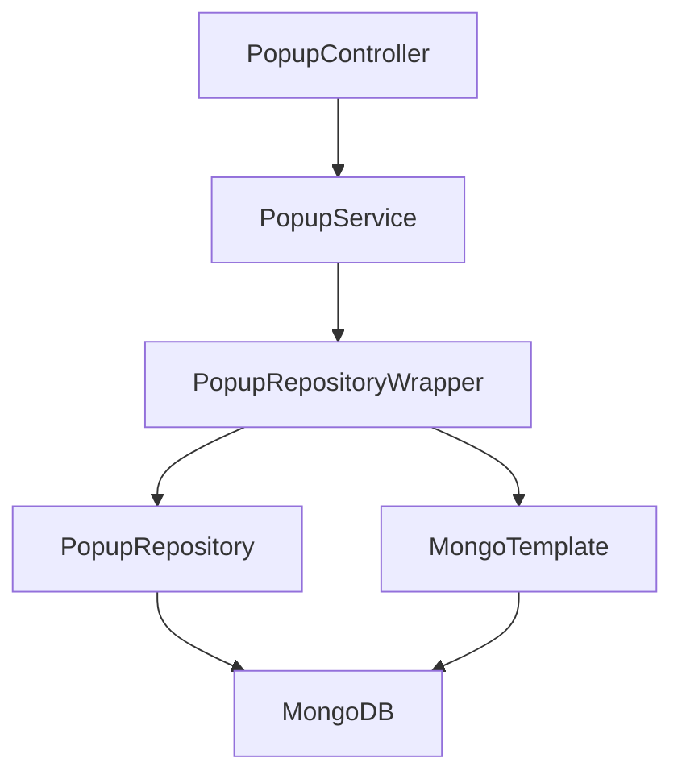

## Popups API (service) — Create + List + Duplicate + Delete

This KB documents the backend endpoints implemented in `service/` for managing Popups.

### Layered ownership (backend)

Flow follows the project’s standard structure:

- **Controller**: HTTP routing + request/response types only
- **Service**: validation + business rules + DTO mapping
- **RepositoryWrapper**: Mongo queries + pagination/sort + save behavior
- **MongoRepository**: basic CRUD interface (Spring Data)
- **MongoDB**: persistence

Mermaid overview:



---

## 1) Create Popup

### Endpoint
- **Method**: `POST`
- **Path**: `/api/v1/popups`

### Auth
Requires a valid token so `TokenService` can resolve:
- `accountId` (ownership scope)
- `createdBy` (audit field on `BaseModel`)

### Request
Type: `CreatePopupRequest`

Fields:
- `name` (required, not blank)
- `type` (required, enum `PopupType`)

Example:

```json
{
  "name": "Welcome popup",
  "type": "WELCOME"
}
```

### Response
Type: `CreatePopupResponse` (built via `CreatePopupResponse.fromEntity(saved)` in the service).

### Business rules (current)
- **Account scoping is mandatory**: if `accountId` is blank → error.
- **Name must be unique (case-insensitive) per account and `PopupType`** among non-deleted rows:
  - `PopupRepositoryWrapper.findByAccountIdAndNameAndType(accountId, name, type)` uses `regex` with `"i"` and `^...$` for exact match.
  - Landing pages, popups, embeds, and other form types may reuse the same display name. Email templates (emnew / classic) are a separate collection and were never in this pool.
  - Duplicate copy names (`"{name} (Copy)"`) are also scoped to the source type.
- New popups are created with:
  - `status = DRAFT`
  - `deleted = false`

### Implementation pointers
- Controller: `service/src/main/java/com/goveca/recruit/ad/controller/PopupController.java`
- Service: `service/src/main/java/com/goveca/recruit/ad/service/PopupService.java`
- Wrapper: `service/src/main/java/com/goveca/recruit/ad/repository/PopupRepositoryWrapper.java`
- Model: `service/src/main/java/com/goveca/recruit/ad/model/Popup.java`

---

## 2) List Popups (paginated)

### Endpoint
- **Method**: `GET`
- **Path**: `/api/v1/popups`

### Query params
- `pageNum` (optional; 1-based; default behavior handled by `CommonRepository.updateQuery`)
- `pageSize` (optional; default handled by `CommonRepository.updateQuery`)
- `status` (optional; filter by `PopupStatus`, case-insensitive)
- `search` (optional; case-insensitive substring match on popup `name` and `type` via Elasticsearch **`popup_*`**; Mongo hydrates rows by id)

Example:

`GET /api/v1/popups?pageNum=1&pageSize=10`

Filter by status:

`GET /api/v1/popups?pageNum=1&pageSize=10&status=PUBLISHED`

Search by name:

`GET /api/v1/popups?pageNum=1&pageSize=10&search=Form`

Search by name:

`GET /api/v1/popups?pageNum=1&pageSize=10&search=Form`

### Response
Type: `PagedResponse<PopupListRowResponse>`

- `data`: list of `PopupListRowResponse`
- `totalElements`: total matching popups for the account (non-deleted)

### Row DTO (placeholder fields)
Type: `PopupListRowResponse`

Fields returned:
- `thumbnailHtml` (placeholder; currently `null`)
- `popupId`
- `name`
- `createdOn`
- `views` (placeholder; currently `0`)
- `conversion` (placeholder; currently `0`)
- `conversionRate` (placeholder; currently `0.0`)
- `status`

### Data rules (current)
- Scope: **accountId only** (via `OwnershipCriteriaUtil.accountCriteria(accountId)`)
- Excludes soft deleted: `deleted != true`
- Optional status filter: when `status` is provided, query adds `status == <PopupStatus>` in Mongo criteria.
- Pagination + sort: applied via `CommonRepository.updateQuery(query, pageNum, pageSize)`
  - In this project, list endpoints typically sort by **updated DESC** as part of the shared helper.

### Implementation pointers
- Controller: `service/src/main/java/com/goveca/recruit/ad/controller/PopupController.java`
- Service: `service/src/main/java/com/goveca/recruit/ad/service/PopupService.java`
- Wrapper: `service/src/main/java/com/goveca/recruit/ad/repository/PopupRepositoryWrapper.java`
- DTO: `service/src/main/java/com/goveca/recruit/ad/response/PopupListRowResponse.java`

---

## 3) Duplicate Popup

### Endpoint
- **Method**: `POST`
- **Path**: `/api/v1/popups/duplicate`

### Auth
Requires a valid token so `TokenService` can resolve:
- `accountId` (ownership scope)
- `createdBy` (audit field on `BaseModel`)

### Request
Type: `DuplicatePopupRequest`

Fields:
- `id` (required; source popup id)

Example:

```json
{
  "id": "SOURCE_POPUP_ID"
}
```

### Response
Type: `CreatePopupResponse` (same shape as create).

### Business rules (current)
- Source popup must exist for the caller’s `accountId` and must not be soft deleted.
- Duplicate popup is created with:
  - `status = DRAFT`
  - `deleted = false`
  - `type` copied from source popup
  - `accountId` and `createdBy` set from current token context (not inherited from source)
- Name is auto-generated to be unique (case-insensitive) within the account:
  - `<sourceName> (Copy)` then `<sourceName> (Copy) 2`, `<sourceName> (Copy) 3`, ...

### Implementation pointers
- Controller: `service/src/main/java/com/goveca/recruit/ad/controller/PopupController.java`
- Service: `service/src/main/java/com/goveca/recruit/ad/service/PopupService.java`
- Wrapper: `service/src/main/java/com/goveca/recruit/ad/repository/PopupRepositoryWrapper.java`
- Request DTO: `service/src/main/java/com/goveca/recruit/ad/request/DuplicatePopupRequest.java`

---

## 4) Delete Popup (hard delete)

### Endpoint
- **Method**: `DELETE`
- **Path**: `/api/v1/popups`

### Auth
Requires a valid token so `TokenService` can resolve:
- `accountId` (ownership scope)

### Request
Type: `DeletePopupRequest`

Fields:
- `id` (required; popup id to delete)

Example:

```json
{
  "id": "POPUP_ID"
}
```

### Response
Type: `DeletePopupResponse`

Example:

```json
{
  "popupId": "POPUP_ID",
  "deleted": true
}
```

### Data rules (current)
- Hard delete is scoped by `accountId` + `_id` (tenant-safe).
- If popup not found for the account, service throws `PopupMessages.popupResourceNotFoundForId(id)` and it maps to **404** in `CommonControllerAdvice`.

### Implementation pointers
- Controller: `service/src/main/java/com/goveca/recruit/ad/controller/PopupController.java`
- Service: `service/src/main/java/com/goveca/recruit/ad/service/PopupService.java`
- Wrapper: `service/src/main/java/com/goveca/recruit/ad/repository/PopupRepositoryWrapper.java`
- Request DTO: `service/src/main/java/com/goveca/recruit/ad/request/DeletePopupRequest.java`
- Response DTO: `service/src/main/java/com/goveca/recruit/ad/response/DeletePopupResponse.java`
- Error message helper: `service/src/main/java/com/goveca/recruit/exception/messages/PopupMessages.java`

---

## Postman quick guide

### Create
- **POST** `/api/v1/popups`
- Headers: `Authorization: Bearer <token>`, `Content-Type: application/json`
- Body: JSON matching `CreatePopupRequest`

### List
- **GET** `/api/v1/popups?pageNum=1&pageSize=10`
- Headers: `Authorization: Bearer <token>`
- Body: none

### List (status filter)
- **GET** `/api/v1/popups?pageNum=1&pageSize=10&status=PUBLISHED`
- Headers: `Authorization: Bearer <token>`
- Body: none

### Duplicate
- **POST** `/api/v1/popups/duplicate`
- Headers: `Authorization: Bearer <token>`, `Content-Type: application/json`
- Body: JSON matching `DuplicatePopupRequest`

### Delete (soft delete)
- **DELETE** `/api/v1/popups`
- Headers: `Authorization: Bearer <token>`, `Content-Type: application/json`
- Body: `{ "ids": ["POPUP_ID_1", "POPUP_ID_2"] }`

### Get one (editor load)
- **GET** `/api/v1/popups/{id}`
- Headers: `Authorization: Bearer <token>`
- Response: `PopupResponse` (`popupId`, `name`, `type`, `status`, `htmlContent`, `metadata`, timestamps)

### Update (editor save)
- **PUT** `/api/v1/popups/{id}`
- Body: `UpdatePopupRequest` — requires `type`; optional `name`, `status`, `htmlContent`, `metadata`
- **Editor Save** (`FormBuilder`) sends `name`, `type`, `htmlContent`, `metadata` only — **omits `status`** so content saves cannot revert publish state changed on PopupDetail or CampaignList while the editor was open. Backend updates `status` only when the field is present (`PopupService.updatePopup`).
- **Status changes** use the same PUT with `status` only (PopupDetail dropdown, CampaignList toggle).
- `metadata.builderState` — JSON string of full builder snapshot (`schemaVersion`, steps, formElements, formStyle, …)
- **Metadata merge on save:** Editor sends builder-owned keys only; backend `PopupMetadataMerge.mergeForUpdate` preserves server-managed keys (`submissionTagId`, legacy `rules`). Frontend also passes through unknown keys from loaded metadata via `preservePassthroughMetadataKeys`.

---

## Frontend wiring (`adflipr-app`)

| Concern | Location |
|---------|----------|
| API client | `src/api/popupApi.ts`, `popupApi.types.ts` |
| Type/status mapping | `src/layouts/PopupBuilder/utils/popupApiMapping.ts` |
| Builder serialization | `src/layouts/PopupBuilder/utils/popupBuilderState.ts` |
| Create → POST | `pages/CreateForm.tsx` |
| List → GET | `pages/CampaignList.tsx` |
| Load/save → GET/PUT | `pages/EditorPage.tsx`, `FormBuilder.tsx` |
