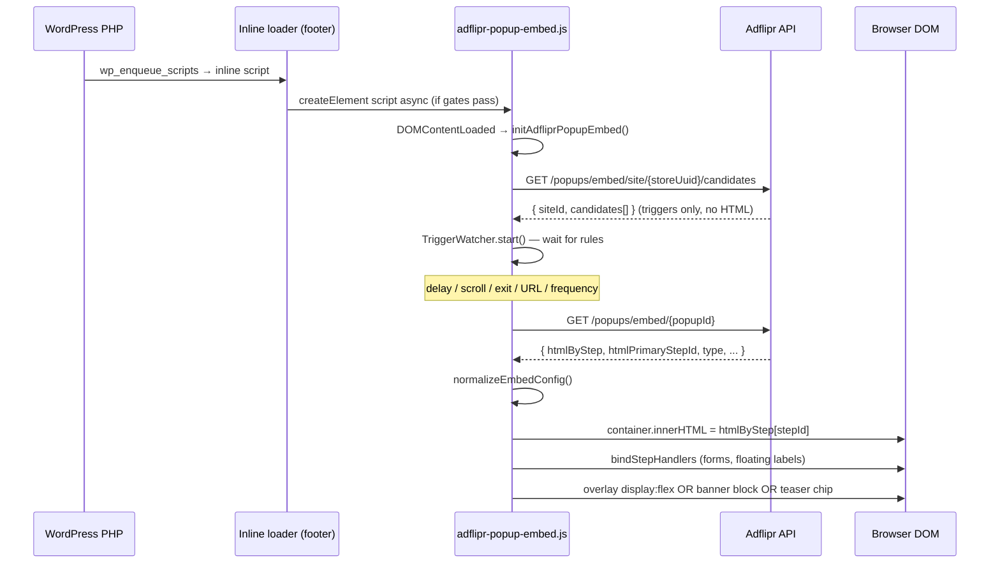

# WordPress popup rendering audit

**Objective:** Trace why popup HTML that looks correct in Adflipr Preview may not appear on a live WordPress storefront.  
**Assumption:** Popup Builder serializer output (`htmlContent` / `htmlByStep`) is valid.  
**Scope:** WordPress plugin → remote embed script → API → DOM visibility. CSS hoisting/cleanup: [`popup-css-lifecycle-audit.md`](./popup-css-lifecycle-audit.md).  
**As of:** 2026-07-04

---

## Critical architecture fact

**The WordPress plugin never receives, stores, sanitizes, or renders popup HTML.**

It only:

1. Checks gates (connected, embed enabled, not admin).
2. Injects a **tiny inline loader** via `wp_add_inline_script`.
3. Loads **`adflipr-popup-embed.js`** from `ADFLIPR_APP_BASE_URL`.
4. Passes `data-adflipr-site` = WordPress `adflipr_store_uuid` and `data-adflipr-popup-api` = API base.

All HTML lifecycle happens in the **browser** after `fetch()` to Adflipr API.

**Adflipr Preview** uses React **`FormCanvas`** — not this pipeline. Preview ≠ WordPress storefront.

---

## 1. Complete rendering pipeline



### Step-by-step reference

| Step | Source file | Function | Input | Output | Failure conditions |
|------|-------------|----------|-------|--------|-------------------|
| Plugin bootstrap | `wordpress/adflipr-for-woocommerce.php` | `load_classes()` | — | Requires `class-adflipr-popup-embed.php` | Class not loaded |
| Register service | `class-adflipr-popup-embed.php` | `Adflipr_Popup_Embed::__construct` | — | Hooks `wp_enqueue_scripts` @20 | — |
| Should load? | `class-adflipr-popup-embed.php` | `adflipr_popup_embed_should_load()` | WP context | `bool` | `is_admin()`, integration inactive, option off, filter false |
| Consent gate | same | `adflipr_popup_embed_wait_for_consent()` | filter | `bool` | `adfliprPopupEmbedConsent===false`; wait for event never fired |
| Resolve site id | `adflipr-install-telemetry.php` | `adflipr_ensure_store_uuid()` | option `adflipr_store_uuid` | UUID string | Empty UUID → **no script at all** |
| Resolve URLs | `adflipr-api-config.php` | `adflipr_api_url`, `ADFLIPR_APP_BASE_URL` | constants/filters | API + app base | Wrong host → 404 script or wrong API |
| Enqueue loader | `class-adflipr-popup-embed.php` | `enqueue_storefront_embed()` | site id, api base | Inline IIFE in footer | Early return on any gate |
| Load embed JS | inline loader IIFE | `load()` | script src | `<script async>` in `<head>` | CSP blocks external script; ad blocker |
| Bootstrap | `embed/index.ts` | `initAdfliprPopupEmbed()` | `document` | overlay runtime init | Uncaught if no site id on script |
| Resolve API/site | `embed/index.ts` | `resolveApiBaseUrl`, `resolveSiteId` | script attrs | strings | Missing attrs → wrong API origin |
| Fetch candidates | `embed/api.ts` | `fetchPopupSiteCandidates()` | siteId, url, visitorId | `PopupSiteEmbedConfig` | 4xx/5xx, CORS (rare), empty candidates |
| Start triggers | `embed/triggers.ts` | `TriggerWatcher.start()` | candidates | listeners + timers | URL mismatch, frequency cap, delay not elapsed |
| Fire popup | `embed/runtime.ts` | `loadAndShowPopup()` | popupId | — | **Unhandled rejection** on fetch/normalize failure |
| Fetch HTML | `embed/api.ts` | `fetchPopupEmbedConfig()` | popupId | JSON with `htmlByStep` | 404 unpublished, no HTML, network error |
| Normalize | `embed/utils.ts` | `normalizeEmbedConfig()` | raw JSON | `PopupEmbedConfig` | Empty/missing `htmlByStep` → null → throw |
| Inject HTML | `embed/runtime.ts` | `renderStepInto()` | step HTML string | `innerHTML` on container | Missing step key → silent return |
| Show shell | `embed/runtime.ts` | `openOverlay` / `openBanner` / `renderTeaser` | mode | `display:flex` / `block` | Overlay `display:none` until open; teaser-only UX |
| Bind events | `embed/runtime.ts` | `bindStepHandlers()` | injected DOM | listeners | — |

### Backend API (HTML source)

| Endpoint | File | Notes |
|----------|------|-------|
| `GET /api/v1/popups/embed/site/{siteId}/candidates` | `PopupController.java` | Published popups only; server URL/device/frequency pre-filter; **no HTML** |
| `GET /api/v1/popups/embed/{popupId}` | `PopupController.java` | **Published only**; returns `htmlByStep` from metadata + `htmlContent` fallback |
| `POST /api/v1/popups/events` | `PopupController.java` | VIEW/SUBMIT telemetry |

HTML assembly: `PopupEmbedResponse.fromEntity()` — parses `metadata.htmlByStep` JSON; falls back to `htmlContent`.

Site key resolution: `PopupEmbedSiteService.resolveAccountIdForSiteKey()` — registry + WooCommerce `storeUuid` session lookup. WordPress passes **`adflipr_store_uuid`** (registered on connect via `registerWooCommerceStore`).

---

## 2. HTML lifecycle — transformation points

| Stage | Modified? | Details |
|-------|-----------|---------|
| Serializer → MongoDB | No (audit assumption) | Stored as saved from builder |
| API JSON response | No content transform | Jackson serializes strings; no HTML re-sanitize at read |
| WordPress PHP | **Never touches HTML** | No proxy, no cache, no `wp_kses` |
| `fetch()` in browser | No | Raw response body → `JSON.parse` |
| `normalizeEmbedConfig()` | **Filters only** | Drops empty step strings; trims keys — can remove steps if blank |
| `innerHTML` assignment | Browser HTML parser | Parses markup; executes **no** scripts in fragment (browser strips `<script>` in innerHTML) |
| DOMParser | **Not used** | — |
| `esc_html` / `wp_kses` | **Not used** | — |
| JSON unicode escapes | Automatic | `\u003c` → `<` on parse — intact HTML after parse |

**Places HTML can change or disappear:**

1. **`normalizeEmbedConfig`** — step omitted if value is empty string after trim.
2. **`openOverlay` / `renderStepInto`** — returns early if `htmlByStep[stepId]` missing (wrong primary step id).
3. **Browser innerHTML** — removes `<script>` tags; `<style>` tags **are** inserted and apply.
4. **Not transformed:** inline `style=""`, `<style>` blocks, `customCss`, rich text inside allowed tags.

---

## 3. CSS lifecycle

| CSS type | Survives to DOM? | Notes |
|----------|------------------|-------|
| Inline `style=""` on elements | Yes | From serializer |
| `<style>` in saved HTML | Yes | Set via `innerHTML`, then **hoisted** to `document.head` by `hoistExportedStepStyles()` (`embed/mountExportedStepStyles.ts`) — clone + remove from container |
| WordPress `wp_enqueue_style` for popup content | N/A | Plugin does not enqueue popup form CSS |
| Embed shell (overlay backdrop) | Yes | Runtime `cssText` on overlay/banner/teaser hosts |
| Teaser animation CSS | Yes | `ensureTeaserExportStyles()` injects `#adflipr-teaser-export-styles` once into head |
| Theme CSS overrides | **Risk** | Generic selectors (`form`, `input`, `button`, `p`) can override if specificity wins; inline styles usually win except `!important` theme rules |
| CSP `style-src` | **Risk** | Strict CSP blocking `'unsafe-inline'` **breaks inline styles and injected `<style>`** |
| CSP `style-src-elem` | **Risk** | May block `<style>` tags from fragment |
| Plugin / WP filters | None on HTML | No `the_content` filter involved |
| Dismiss without destroy | **Risk** | Hoisted head styles **remain** after overlay close — PCL-001 in [`popup-css-lifecycle-audit.md`](./popup-css-lifecycle-audit.md) |

**WordPress does not strip styles** from popup HTML because HTML never passes through WordPress rendering filters.

**Canonical CSS lifecycle audit:** [`popup-css-lifecycle-audit.md`](./popup-css-lifecycle-audit.md).

---

## 4. JavaScript lifecycle

| Item | Location | Behavior |
|------|----------|----------|
| Entry (WP) | Inline loader in footer | Loads external script once (`__adfliprPopupEmbedLoaded`) |
| Entry (embed) | `embed/index.ts` bottom | `DOMContentLoaded` or immediate `initAdfliprPopupEmbed(document)` |
| Global API | `attachAdfliprPopupGlobal` | `window.AdfliprPopup.init()` / `.mount()` |
| Overlay init | `initOverlayRuntime` → `runtime.init()` | Async candidates fetch |
| Trigger listeners | `TriggerWatcher.attachListeners` | scroll, mouseout (exit), click (custom), delay timers, inactivity timers |
| MutationObserver | **None** | — |
| Floating label JS | `bindStepHandlers` | After each `innerHTML` — toggles `.pbn-floating-field--floated` |
| Form submit | `bindStepHandlers` | `preventDefault` + telemetry + step transition |

**Init before HTML exists:** By design. HTML is fetched **after** trigger fires, not at page load.

**Race conditions:**

- Trigger fires → `loadAndShowPopup` async; **no loading UI**; failure = silent (unhandled rejection).
- `TriggerWatcher.stop()` called when winner fires — failed HTML fetch does not retry other candidates.
- Consent loader: if `wait=true` and event never dispatched, embed JS never loads.

---

## 5. DOM visibility

| Check | Overlay popup | Sticky banner | Teaser | Inline embed |
|-------|---------------|---------------|--------|--------------|
| Inserted into DOM? | `#adflipr-popup-embed-root` on `body` | `.adflipr-popup-embed-banner` on `body` | fixed div on `body` | mount element `innerHTML` |
| Hidden by default? | `overlayEl` created with `display:flex` but **closed via `display:none`** until open | `display:none` until open | Visible when rendered | Visible on inject |
| `opacity:0` | No (unless theme) | No | No | No |
| `visibility:hidden` | No (unless theme) | No | No | No |
| z-index | **2147483000** (overlay), 2147482000 (teaser) | 2147483000 | 2147482000 | inherits mount |
| `pointer-events` | overlay clickable | auto | auto | — |
| Off-screen transform | No (unless theme on children) | No | No | No |

**Popup exists but invisible — causes:**

1. **Trigger never satisfied** — most common (delay, scroll, exit intent, URL rules, custom click selector).
2. **Teaser mode** — only small teaser chip visible; full overlay after click.
3. **Overlay dismissed** — `display:none` on overlay; teaser shown again if configured.
4. **Frequency cap** — localStorage `adflipr_popup_seen_{popupId}` or server-side VIEW events.
5. **Empty candidates** — nothing fetched; no DOM created.
6. **HTML fetch failed** — no injection; may have no user-visible error.
7. **Theme `!important` or `display:none` on `form`** — rare with inline styles.
8. **Parent stacking context** — unlikely given z-index magnitude; possible with broken CSS isolation in theme.

---

## 6. Asynchronous flow

```
Page load
  → loader runs (sync)
  → embed.js downloads (async)
  → DOMContentLoaded → init() (async)
      → fetch candidates (await)
      → TriggerWatcher.start (sync setup, async timers)
  → [user waits: delay / scroll / exit ...]
  → onFire(popupId) (sync callback)
      → loadAndShowPopup (async, no await at call site)
          → fetch embed config (await)
          → presentConfig → innerHTML
```

| Concern | Assessment |
|---------|------------|
| Retries | **None** on candidate or HTML fetch |
| Promise errors | `init()` caught with `console.warn`; **`loadAndShowPopup` not caught** |
| Depends on data not yet existing | Candidates before HTML (by design); HTML before trigger (by design) |
| Cache | API `Cache-Control: public, max-age=60` on embed GETs |

---

## 7. WordPress integration

| Mechanism | Used? | Details |
|-----------|-------|---------|
| `wp_enqueue_script` | Yes | `adflipr-popup-embed-loader` — empty handle, inline only, **footer** (`true`) |
| `wp_enqueue_style` | **No** | No popup CSS from plugin |
| `wp_footer` | Indirect | Footer scripts via enqueue |
| `wp_head` | Indirect | Loader appends embed script to **`document.head`** |
| Shortcode | **No** | No popup shortcode |
| AJAX | **No** | Popups use public REST from browser, not `admin-ajax.php` |
| Runs every page? | **Only frontend** when all gates pass | Not admin, not if disconnected/disabled |

### Gates (all must pass)

1. `! is_admin()`
2. `adflipr_integration_is_active()` — option `adflipr_integration_active` (soft disconnect = `'0'`)
3. `adflipr_popup_embed_option_enabled()` — option `adflipr_popup_embed_enabled`
4. `apply_filters('adflipr_popup_embed_enabled', true)`
5. Valid `adflipr_store_uuid`
6. Consent: not `adfliprPopupEmbedConsent === false`; if `adflipr_popup_embed_wait_for_consent` → need `true` or `adflipr:popup-embed:allow` event

---

## 8. Browser compatibility

| Feature | Used? | WP impact |
|---------|-------|-----------|
| Shadow DOM | **No** | — |
| iframe for popup | **No** (YouTube iframe inside content only) | — |
| CSP | Site-dependent | Can block inline styles, external script, or connect-src to API |
| cross-origin | Yes | API on `adflipr.com`, site on merchant domain — CORS allowed (`*` on embed paths) |
| lazy loading | embed script `async` | — |
| deferred | async only | — |
| localStorage | Yes | visitor id + frequency caps — blocked in strict private mode / IT policies |

---

## 9. Runtime logging suggestions

Add temporary `console.info` (or debug flag) at:

| Stage | File | Location | Suggested log |
|-------|------|----------|---------------|
| ✓ WP gates | `class-adflipr-popup-embed.php` | start of `enqueue_storefront_embed()` | `[AdfliprWP] embed enqueue siteId=… api=…` |
| ✓ Loader | inline IIFE | `load()` | `[AdfliprWP] loading embed script` |
| ✓ Script attrs | `embed/index.ts` | `initAdfliprPopupEmbed` | `[AdfliprPopup] api=… site=…` |
| ✓ Candidates | `embed/api.ts` | after `fetchPopupSiteCandidates` | `[AdfliprPopup] candidates count=…` |
| ✓ Trigger fire | `embed/triggers.ts` | `fireWinner` | `[AdfliprPopup] trigger fired popupId=…` |
| ✓ HTML received | `embed/runtime.ts` | after `fetchPopupEmbedConfig` | `[AdfliprPopup] html steps=… primary=…` |
| ✓ HTML injected | `embed/runtime.ts` | `renderStepInto` | `[AdfliprPopup] injected step=… bytes=…` |
| ✓ DOM node | `embed/runtime.ts` | `ensureOverlayShell` | `[AdfliprPopup] overlay root created` |
| ✓ CSS applied | `embed/runtime.ts` | `openOverlay` / `openBanner` | `[AdfliprPopup] mode=… display=…` |
| ✓ Popup shown | `embed/runtime.ts` | end of `openOverlay` | `[AdfliprPopup] visible step=…` |
| ✗ Failures | `embed/runtime.ts` | wrap `loadAndShowPopup` in try/catch | `[AdfliprPopup] show failed` + error |

Also log in browser Network tab:

- `GET …/popups/embed/site/{uuid}/candidates` → 200 + candidate count
- `GET …/popups/embed/{popupId}` → 200 + `htmlByStep` keys

---

## 10. Deliverables summary

### 10.1 Transformation points (complete list)

1. MongoDB storage (builder save)
2. `PopupEmbedResponse.fromEntity` — metadata parse / htmlContent fallback
3. JSON serialization over HTTP
4. `normalizeEmbedConfig` — empty step removal
5. Browser `innerHTML` parser — strips `<script>`; keeps `<style>` and inline styles
6. Theme CSS cascade on injected nodes
7. CSP enforcement (site-level, not WordPress plugin)

**Not in path:** WordPress PHP, `wp_kses`, DOMParser, HTML escaping.

### 10.2 Race conditions

- Trigger winner fires before HTML fetch completes (expected; no UI feedback).
- Failed HTML fetch after trigger stopped — no fallback candidate.
- Consent deferred load vs fast navigation away.
- 60s API cache serves stale empty HTML briefly after publish.

### 10.3 CSS conflicts

- Theme generic form/button rules vs inline popup styles.
- Theme `!important` overrides.
- Strict CSP blocking inline styles / `<style>` tags.
- Floating label classes (`.pbn-floating-field`) could collide if theme uses same prefix (unlikely).

### 10.4 DOM visibility issues

- Overlay `display:none` until trigger + successful fetch.
- Teaser-only presentation.
- Post-dismiss hidden state + frequency cap.
- Zero-size content if HTML empty or step missing.

### 10.5 JavaScript initialization issues

- Embed script blocked or 404.
- `init()` fails silently (`console.warn` only).
- `loadAndShowPopup` uncaught rejection.
- Consent gate never cleared.
- `adfliprPopupEmbedConsent === false` blocks loader entirely.

### 10.6 WordPress integration issues

- Soft disconnect (`adflipr_integration_active = 0`).
- Popup embed option off.
- Missing store UUID.
- Wrong `ADFLIPR_API_BASE_URL` / `ADFLIPR_APP_BASE_URL`.
- Filter `adflipr_popup_embed_enabled` returns false.
- Cookie consent filter without dispatching `adflipr:popup-embed:allow`.

### 10.7 Security / sanitization

- HTML sanitized **at builder save**, not at WordPress or embed read.
- Public embed endpoints — no auth; published popups only.
- `innerHTML` — no script execution from popup HTML (good).
- Visitor id in localStorage — privacy/consent consideration (documented in readme).

### 10.8 Performance

- Two HTTP round-trips per show (candidates + HTML) — lazy by design.
- 60s cache on embed GET.
- Large inline HTML in JSON — parse + innerHTML cost on main thread.
- Multiple trigger listeners until first fire.

---

## 11. Top 10 — Preview works, WordPress does not

Ranked by likelihood in production:

| # | Reason | Why preview still works |
|---|--------|-------------------------|
| 1 | **Popup not PUBLISHED (live)** | Preview uses builder state; embed API returns 403/error for draft |
| 2 | **Display triggers not met** (delay, scroll depth, exit intent, inactivity) | Preview modal opens immediately in builder |
| 3 | **URL / location targeting** excludes current WP page | Preview ignores storefront URL rules |
| 4 | **Frequency cap** (localStorage or server VIEW events) | Preview does not persist visitor frequency |
| 5 | **WordPress embed gates** — disconnected, embed disabled, consent wait | Preview runs inside Adflipr app |
| 6 | **Empty `htmlByStep` on save** — never saved after edit | Preview uses live React canvas, not saved HTML |
| 7 | **Device / rules panel** filters candidate server-side | Preview device toggle ≠ User-Agent classification |
| 8 | **Teaser-only first** — user expects full modal | Preview may show selected step directly |
| 9 | **Strict CSP or ad blocker** blocks script/styles | Preview runs on Adflipr origin |
| 10 | **Preview is React canvas, not serialized HTML** | WYSIWYG gap — export HTML differs from canvas |

---

## 12. Debugging checklist (WordPress merchant)

1. View page source — search for `adflipr-popup-embed-loader` or `__adfliprPopupEmbedLoaded`.
2. Network — script `adflipr-popup-embed.js` loads (200).
3. Network — `GET /api/v1/popups/embed/site/{storeUuid}/candidates` returns candidates.
4. Confirm popup **Published** in Adflipr.
5. Confirm **Save** after edits (htmlByStep populated).
6. Clear `localStorage` keys `adflipr_popup_seen_*` and retest.
7. Test with display triggers disabled / page-load only.
8. Check `adflipr_integration_active` and `adflipr_popup_embed_enabled` options.
9. Compare User-Agent vs device rules.
10. Inspect `#adflipr-popup-embed-root` in DOM after waiting for trigger delay.

---

## 13. Related files

| Area | Path |
|------|------|
| WP loader | `wordpress/includes/class-adflipr-popup-embed.php` |
| Store UUID | `wordpress/includes/adflipr-install-telemetry.php` |
| API URLs | `wordpress/includes/adflipr-api-config.php` |
| Embed bootstrap | `adflipr-app/src/layouts/PopupBuilder/embed/index.ts` |
| Runtime / innerHTML | `adflipr-app/src/layouts/PopupBuilder/embed/runtime.ts` |
| Triggers | `adflipr-app/src/layouts/PopupBuilder/embed/triggers.ts` |
| Built script | `adflipr-app/public/adflipr-popup-embed.js` |
| API | `service/.../PopupController.java`, `PopupEmbedResponse.java` |
| Block ownership | `ai/kb/popup-block-css-phase5a-ownership-audit.md` |
